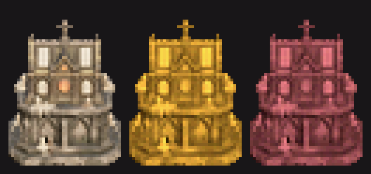

# Relicarios normales en pasillos, relicario dorado en jefes y Altar final (`feat/relicarios-boss`)

## Qué cambia
- **15 stages en 3 actos (5 por acto):** 4 encuentros y 1 jefe por acto, con El Abanderado en los stages **5, 10 y 15** (repetido en el 10 y el 15 hasta diseñar al Campanero y a El Paso).
- **14 pasillos con relicario normal:** todos los pasillos entre niveles llevan el relicario normal (sin aro dorado) y dan **1 Don** al romperlo. Se retira `ENC_GOLDEN_AFTER`.
- **Relicario dorado en la sala de cada jefe:** al derrotar al jefe de los stages 5, 10 o 15 ya no salta la pantalla de Reliquia automáticamente; en su lugar aparece un **relicario dorado** en la propia sala del jefe que da **1 Reliquia** al romperlo (3 Reliquias por partida), y se abre la verja de salida.
- **Altar final:** tras vencer al jefe del stage 15, el pasillo posterior contiene el **Altar** en lugar de un relicario normal; al destruirlo termina la partida con **«Fin de la demo»**.

## Evidencia
Comparativa 4x (relicario de pasillo actual, variación dorada para sala de jefe y variación carmesí provisional para el Altar):

## Revisión de documentos
- Actualizados `DESIGN.md` (§ Estado vigente, Bucle, §6.13.1, §6.13.5 y §6.13.6) y `STATUS.md`. Sin cambios en `TECHNICAL.md`, `LORE.md`, `assets/MANIFEST.md` ni `AGENTS.md`.

## Verificación
- Build ROM `default`: `DS_BUILD=PASS` (0 avisos).
- Host tests (`test_guardrails`): PASS.
