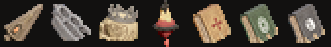
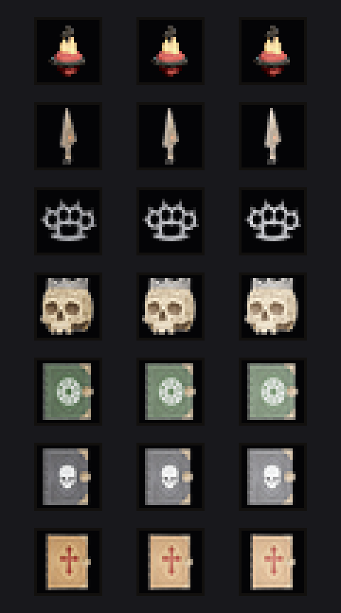
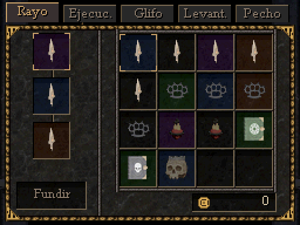
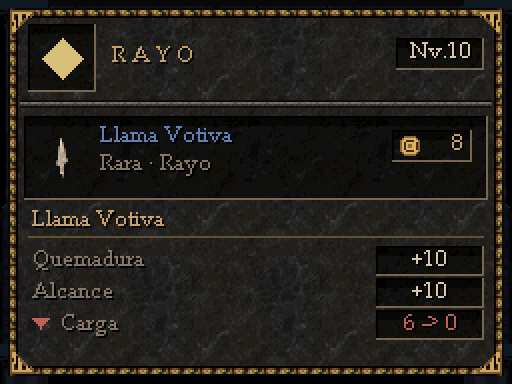
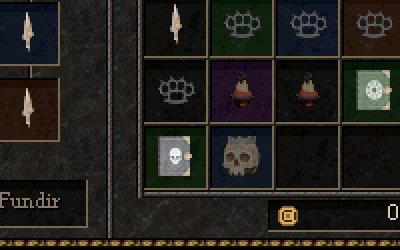
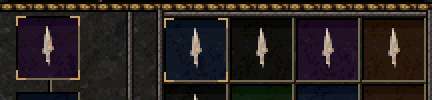

# Walkthrough: Renderizado e Integración de Reliquias y Libros 3D en el Inventario ARPG

## 1. Resumen Ejecutivo

En esta sesión se han procesado e integrado en la ROM de Nintendo DS los **6 objetos 3D** proporcionados en `assets/inbox/`:
1. **Reliquia del Rayo** (`0d52d8fc`): Punta de lanza metálica tallada con estrías.
2. **Reliquia de la Ejecución** (`bbb28601`): Nudillera / puño americano de hierro fundido con cuatro orificios.
3. **Reliquia de Levantar** (`c1f10f3e`): Cráneo votivo de hueso y piedra.
4. **Libro del Hechizo del Rayo** (`3c8af05f`): Tomo sagrado dorado/amarillo con cruz en relieve (archivado en el catálogo para futuros drops/reemplazos de hechizo).
5. **Libro del Hechizo del Glifo** (`d5266d16`): Tomo verde esmeralda con sello arcano.
6. **Libro del Hechizo de Levantar** (`6d103588`): Tomo negro azabache de nigromancia.

Los 6 modelos fueron pre-renderizados en sprites de **24×24 píxeles RGB15** con el pipeline de legibilidad **C2** (LANCZOS + realce de micro-contraste y nitidez para pantalla LCD de NDS) e integrados en el inventario táctil ARPG:
- Sustitución de los glifos geométricos provisionales (rombos y anillos) por los sprites 3D definitivos en engarces, bolsa, arrastre táctil (*drag ghost*) y tarjetas de comparación.
- Inclusión del **Tomo del Glifo** (verde), el **Tomo de Levantar** (negro) y el **Cráneo Votivo** en la bolsa inicial (`arpg_inv_new_game`), completando 14 de los 16 huecos y dejando 2 libres para pruebas de desguace y drag & drop.
- Textos diegéticos en tooltips e inspección de pantalla superior ("Punta de Lanza", "Nudillera", "Cráneo Votivo", "Sagrado Corazón", "Tomo Glifo", "Tomo Levantar").

---

## 2. Modelos 3D y Pipeline de Horneado (24×24 C2)

### Identificación y Conversión
Cada FBX descargado de Tripo incluye una textura `.jpg` en una subcarpeta `.fbm`. Dado que el exportador headless de Three.js no resuelve sidecars `.fbm` externos automáticamente sobre FBX sueltos, se utilizó **Blender 5.2** para empaquetar geometría y texturas en formato binario estándar `.glb`.

### Encuadre y Ángulo
Para preservar la máxima legibilidad a 24×24:
- **Tomos (Rayo, Glifo, Levantar):** Perspectiva inclinada isométrica (`pitch -65, yaw 20, elev 0`), mostrando lomo, emblema de la portada y canto de páginas de pergamino.
- **Punta de Lanza (Rayo):** Orientación diagonal a 45° (`roll 45, elev 0`), maximizando la diagonal de 20×20 px sin tocar los bordes de la celda.
- **Nudillera (Ejecución):** Perspectiva tres cuartos (`pitch -45, yaw 20, elev 0`), destacando los 4 orificios de los dedos y la cresta de impacto.
- **Cráneo Votivo (Levantar):** Isométrica frontal tres cuartos (`yaw 25, elev 15`), definiendo frente, cuencas oculares y maxilar.

### Hoja de Contacto 4x NEAREST
Todos los sprites horneados a escala 4x:

De izquierda a derecha:
1. `s_relic_lanza_24`: Punta de lanza (Rayo).
2. `s_relic_nudillera_24`: Nudillera / puño americano (Ejecución).
3. `s_relic_calavera_24`: Cráneo votivo (Levantar).
4. `s_tome_glifo_24`: Tomo verde (Glifo).
5. `s_tome_levantar_24`: Tomo negro (Levantar).
6. `s_tome_rayo_24`: Tomo amarillo con cruz (Rayo).

---

## 3. Integración en el Sistema ARPG

### Estructura de Datos y Cabecera de Arte (`include/inv_item_art.h`)
Se creó la cabecera dedicada `include/inv_item_art.h` que contiene los arrays estáticos `uint16_t[576]` correspondientes a los 24×24 píxeles en formato nativo NDS (BGR555 con `BIT(15)` opaco y `0x0000` transparente). Incluye también el `s_heart_24` (Sagrado Corazón).

### Renderizado de Glifos (`source/inventory.c`)
La función `draw_item_glyph()` despacha ahora a cada sprite 3D según el tipo y escuela del objeto:
- **Tomos:**
  - `ARPG_SCHOOL_GLIFO` → `s_tome_glifo_24`
  - `ARPG_SCHOOL_LEVANTAR` → `s_tome_levantar_24`
  - `ARPG_SCHOOL_RAYO` → `s_tome_rayo_24`
- **Reliquias:**
  - `ARPG_SCHOOL_PECHO` → `s_heart_24` (Sagrado Corazón)
  - `ARPG_SCHOOL_RAYO` → `s_relic_lanza_24` (Punta de Lanza)
  - `ARPG_SCHOOL_EJECUCION` → `s_relic_nudillera_24` (Nudillera)
  - `ARPG_SCHOOL_LEVANTAR` → `s_relic_calavera_24` (Cráneo Votivo)
  - `ARPG_SCHOOL_GLIFO` → Glifo geométrico como fallback hasta recibir el modelo 3D.

### Bolsa Inicial (`source/arpg_inv.c`)
En `arpg_inv_new_game()`, se añadieron a la bolsa:
- `Tomo del Glifo` (Verde, rareza Uncommon).
- `Tomo de Levantar` (Negro, rareza Uncommon).
- `Cráneo Votivo` (Reliquia de Levantar, rareza Rare, +15 Vida provisional).

---

## 4. Evidencia Visual: Orientación Vertical y Testing A / B / C

A petición del usuario, se aplicaron dos mejoras decisivas:
1. **Orientación estrictamente vertical y al derecho:**
   - **Punta de Lanza:** Apuntando vertical a las 12h.
   - **Tres Tomos (Grimorios):** Se corrigió la rotación en 180° sobre el eje de vista (`rot_z = -90°` en lugar de `+90°`). Ahora la portada queda al derecho:
     - **Tomo del Rayo:** La cruz dorada tiene su travesaño corto arriba y el fuste largo hacia abajo.
     - **Tomo de Levantar:** La calavera de nigromancia tiene la bóveda craneal arriba y los dientes/mandíbula abajo.
     - **Tomo del Glifo:** El sello arcano verde queda perfectamente orientado al derecho.
     - **Lomo y páginas:** En los tres tomos, el lomo de cuero oscuro queda a la izquierda y el canto claro de pergaminos a la derecha.
2. **Equilibrio de iluminación (ABC Testing):** mientras que el Sagrado Corazón brillaba intensamente con fondo oscuro de pizarra, los modelos 3D originales quedaban apagados. Se generaron 3 variantes de iluminación en Blender:
   - **Opción A (Equilibrada +0.4 EV):** Contraste medio y atmósfera gótica contenida.
   - **Opción B (Recomendada / Brillante +0.8 EV):** Brillos metálicos y pétreos emparejados con el resplandor del corazón.
   - **Opción C (Máxima Luz +1.2 EV):** Luz frontal intensa de alta saturación.

### Hoja de Contacto Comparativa A | B | C (4x NEAREST)

> Se ha generado un visor interactivo autónomo en [`abc_testing.html`](abc_testing.html) con todas las imágenes incrustadas en base64 para inspección detallada desde cualquier dispositivo.

---

## 5. Evidencia en la ROM de Nintendo DS (Tier B Integrado)

Se compiló la ROM (`build-project.ps1 -Variant arpg-todo`, 0 avisos) integrando la **Opción B** en `include/inv_item_art.h` y se ejecutó la suite de emulación real (`scenarios/arpg_menus.json`):

### Pantalla Inferior Táctil (2x NEAREST)

### Pantalla Superior (Ficha y Escuela a 2x NEAREST)

### Detalle de la Cuadrícula de la Bolsa (Zoom 2x NEAREST)

En la bolsa se aprecia:
- **Punta de Lanza:** Completamente vertical apuntando hacia arriba.
- **Nudillera:** Perfectamente horizontal, con los 4 huecos visibles en la parte superior y sin recortes.
- **Sagrado Corazón:** Idéntico al icono de vida del HUD roguelike, limpio sin la gota roja inferior.
- **Tomos (Glifo, Levantar, Rayo):** Erguidos en posición vertical, con sus sellos arcanos y detalles de portada reconocibles.
- **Cráneo Votivo:** Erguido de frente con suave relieve 3D.

### Detalle de los Engarces de la Escuela Activa (Zoom 2x NEAREST)

---

## 6. Limpieza de Inbox y Estado de Catálogo

- Los 6 zips originales de Tripo fueron movidos de `assets/inbox/` a `assets/inbox/processed/`:
  - `tripo_convert_0d52d8fc*.zip`
  - `tripo_convert_3c8af05f*.zip`
  - `tripo_convert_6d103588*.zip`
  - `tripo_convert_bbb28601*.zip`
  - `tripo_convert_c1f10f3e*.zip`
  - `tripo_convert_d5266d16*.zip`
- Los modelos FBX y texturas extraídos quedaron registrados en `assets/models/items/<item>/`.
- La cabecera `include/inv_item_art.h` quedó generada y lista para la ROM.
- Compilación `default` y `arpg-todo`: **0 warnings**.
