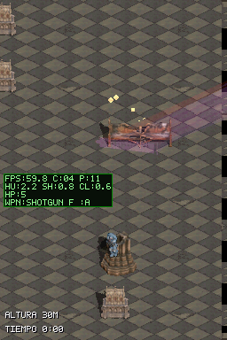
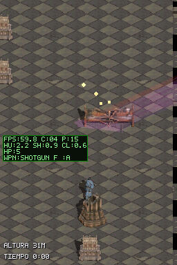

# Retirada del parpadeo y la línea negra tras muros

## Decisión

El personaje y los enemigos quedan ocultos por la profundidad horneada de muros y props. No se revelan con parpadeo, transparencia condicionada ni guías dibujadas sobre el muro. Decisión anotada en `DESIGN.md` §3.

## Cambios

- Quitado el bypass de oclusión por paridad de frame en `blit_stride`; los píxeles de todos los actores vuelven a pasar por el mismo test de profundidad.
- Quitado el estado `s_player_see_through` y el pase que dejaba la sombra del jugador visible sobre una superficie oclusora.
- Eliminados `draw_hidden_wall_base()` y sus rutinas auxiliares, que pintaban una línea negra desde las celdas de colisión.
- Retirados del perfilador el tiempo de esa línea y los contadores de alternancia/visibilidad.

## Evidencia de la ROM

En la primera captura el personaje está detenido junto a la columna; la oclusión horneada sigue tapando sus píxeles sin transparencia alterna. En la segunda, al retroceder, el personaje queda delante.

## Verificación

- Build `cathedral-playground-perf`: PASS, 0 warnings nuevos.
- Suite host: 9 PASS; incluye contrato de ausencia de los efectos y de oclusión por profundidad.
- Escenarios DeSmuME: `cathedral_props_depth_collision` y `cathedral_playground_respawn` PASS.
- La subida se intentó con autorización, pero el FTP de la DS no respondió en `192.168.1.151:5000`; no se reintentó. Falta abrir `ftpd.nds`, subir esta ROM y comprobarla en la DS física con `PERF_PROFILE`.

## Actualización 2026-11-10

La variante `cathedral-playground-perf` se subió después como `dungeonds.nds` (2.009.088 bytes; rama `feat/muros-catedral`, base `2def813`) y el usuario la probó. Rendimiento y estética general: bien. La revisión encontró que las colisiones y oclusiones de los props siguen mal; eso no revierte la retirada de los efectos, pero deja abierta la corrección de profundidad/huellas. Ver [cierre de catedral](../catedral-cierre/walkthrough.md).
