# Render rápido de personajes (sin navegador)

Rama `perf/render-rapido`, 2026-11-21. Sustituye el lab Three.js de Chromium por un exportador en Node puro (`tools/lab/fast/`) con un rasterizador por software. Se activa con `DS_FAST_RENDER=1`; sin esa variable `rebuild_all.py` sigue usando el lab lento.

## Tiempos (rebuild_all --only characters --jobs 4, 16 personajes)

| | Lab lento (Chromium) | Nuevo (Node) |
|---|---|---|
| Total | **113 s** | **29 s** |

Es una ejecución con 4 personajes a la vez, así que cada uno compite por CPU con los demás. Medido solo, un personaje tarda ~25 s en el lab y 2,2–3,6 s en el nuevo (≈7–11×).

## Fidelidad y tiempo por personaje

IoU = solapamiento de la silueta (1,0 = idéntica). Error = diferencia media de color en píxeles opacos (sobre 255). Los segundos son por personaje dentro de la ejecución paralela.

| Personaje | Lento (s) | Nuevo (s) | IoU silueta | Error color |
|---|---|---|---|---|
| abanderado | 23.7 | 5.5 | 0.9974 | 5.34 |
| abanderado_point | 24.7 | 7.0 | 0.9973 | 5.65 |
| cireneo | 29.0 | 6.9 | 0.9977 | 3.83 |
| cireneo_charge | 29.9 | 7.3 | 0.9983 | 3.54 |
| cireneo_telegraph | 29.8 | 7.2 | 0.9977 | 3.73 |
| corazon | 23.1 | 4.3 | 0.9984 | 3.80 |
| corazon_agachado_andar | 19.4 | 4.3 | 0.9984 | 3.60 |
| corazon_disparo | 19.5 | 4.7 | 0.9977 | 3.77 |
| exvoto | 23.1 | 5.4 | 0.9961 | 6.00 |
| exvoto_pray_kneel | 21.8 | 6.4 | 0.9971 | 6.34 |
| exvoto_pray_stand | 21.9 | 5.6 | 0.9971 | 6.50 |
| exvoto_stand_up | 19.8 | 5.8 | 0.9976 | 6.70 |
| monaguillo | 23.1 | 5.5 | 0.9980 | 5.42 |
| ojo | 23.7 | 5.4 | 0.9984 | 3.43 |
| ojo_look | 25.7 | 8.1 | 0.9987 | 3.39 |
| ojo_sentence | 24.6 | 7.5 | 0.9983 | 3.41 |

## Imágenes y GIF (para juzgar a ojo)

Fila superior = lab lento, fila inferior = nuevo. Estáticos: las 8 direcciones, fotograma 0. GIF: ciclo completo de 4 direcciones (S, O, N, E), 60 ms por fotograma (≈16 fps), 4× sin suavizar.

### abanderado

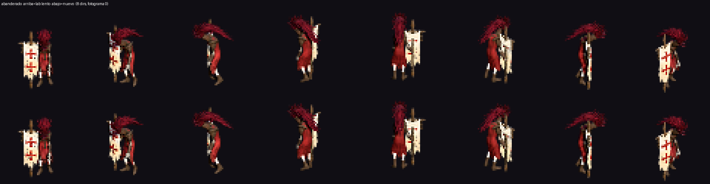

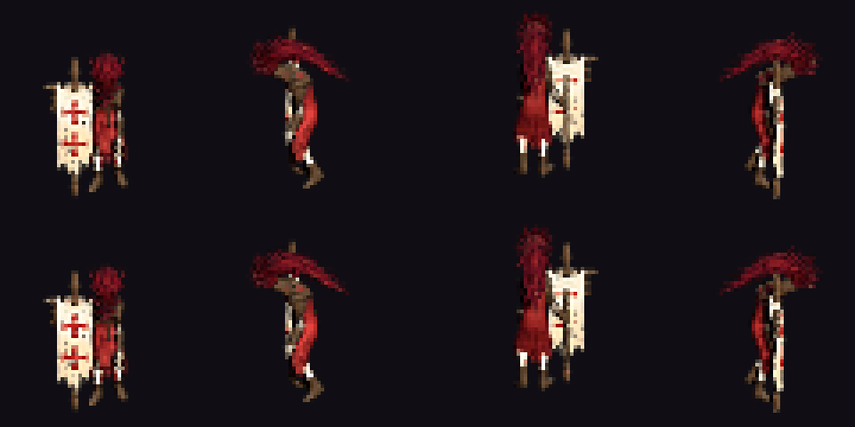

### abanderado_point

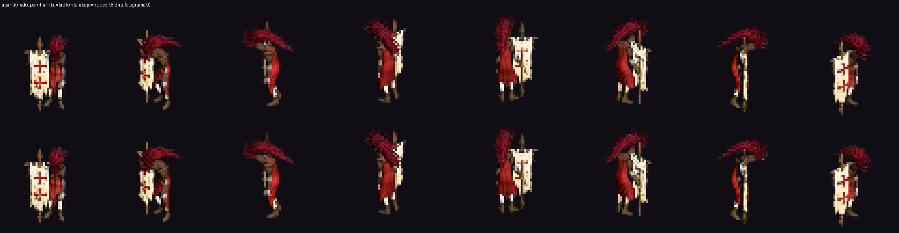

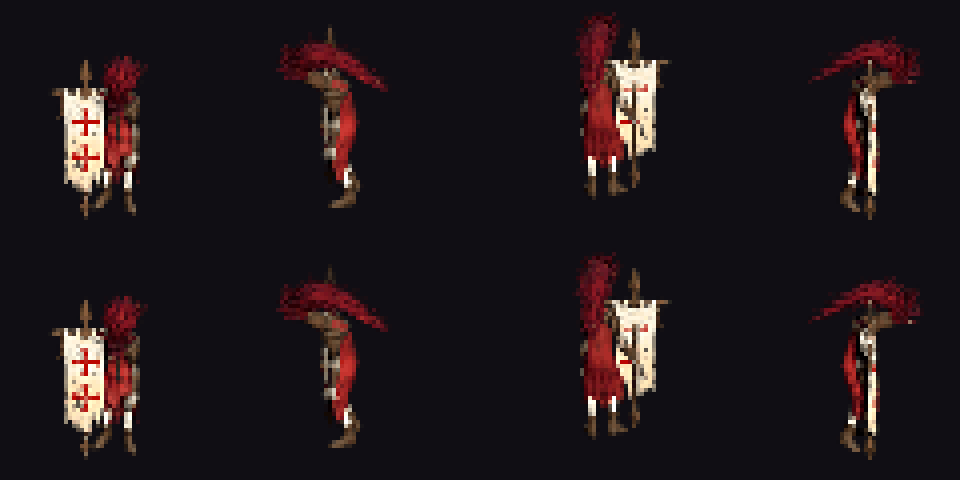

### cireneo

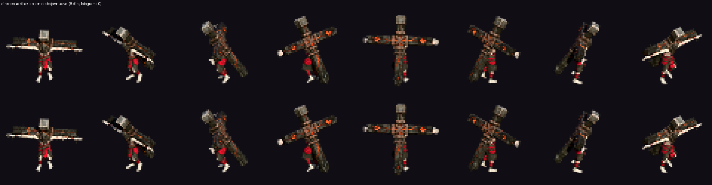

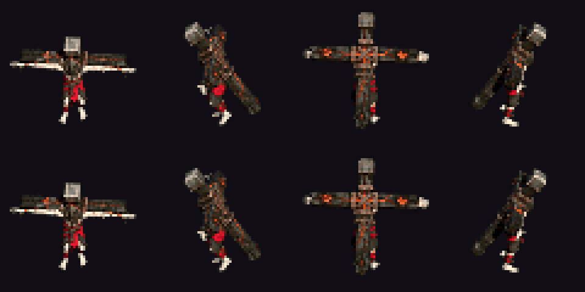

### cireneo_charge

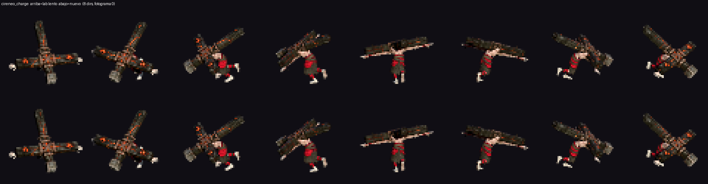

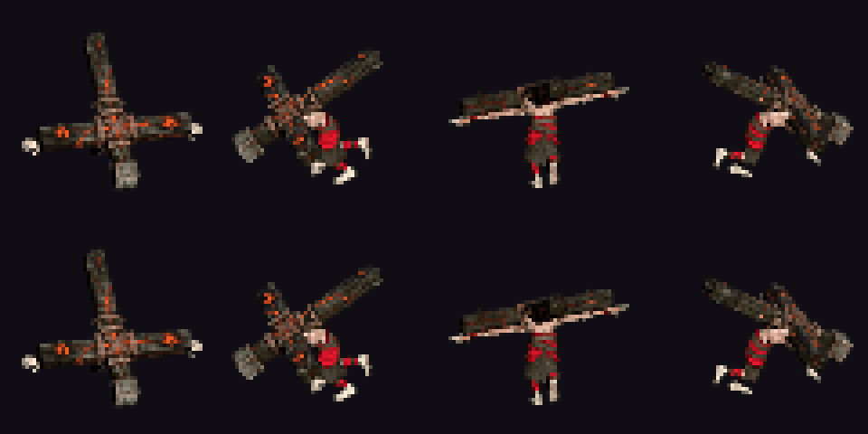

### cireneo_telegraph

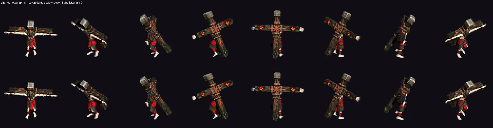

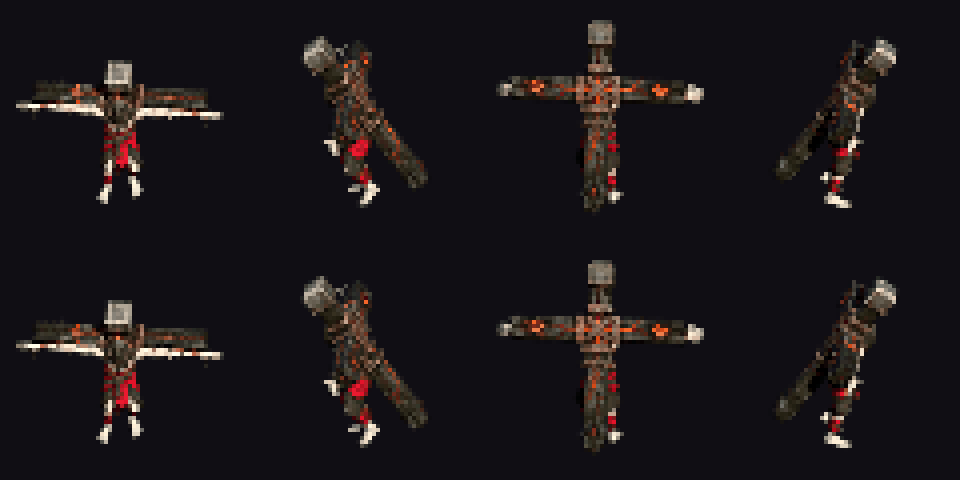

### corazon

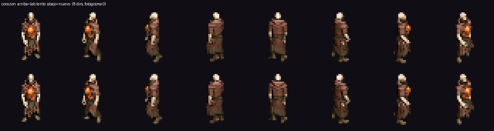

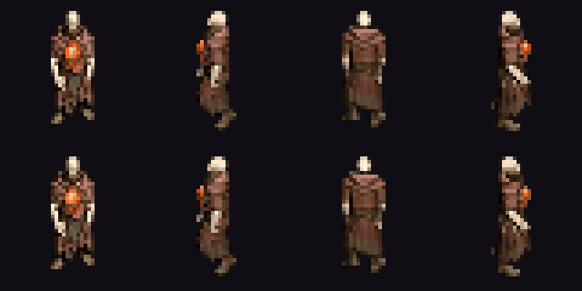

### corazon_agachado_andar

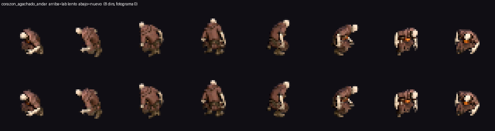

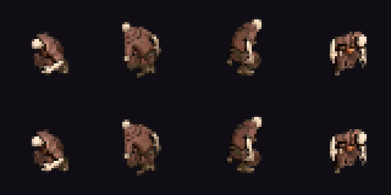

### corazon_disparo

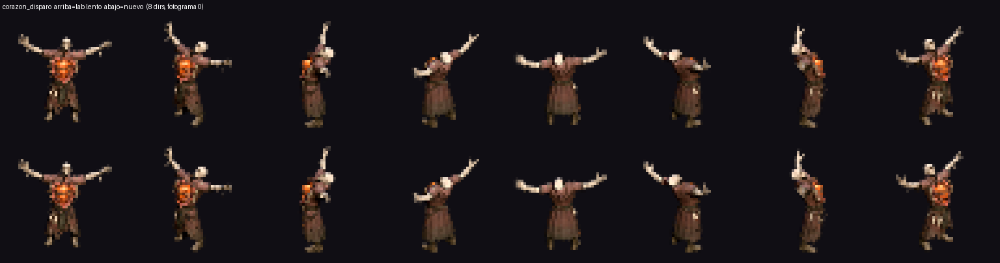

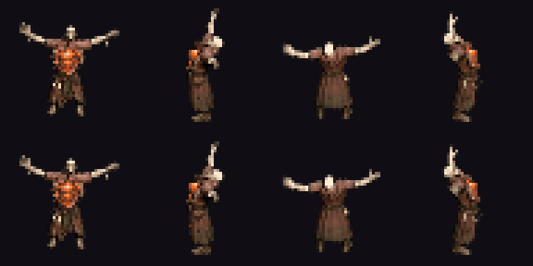

### exvoto

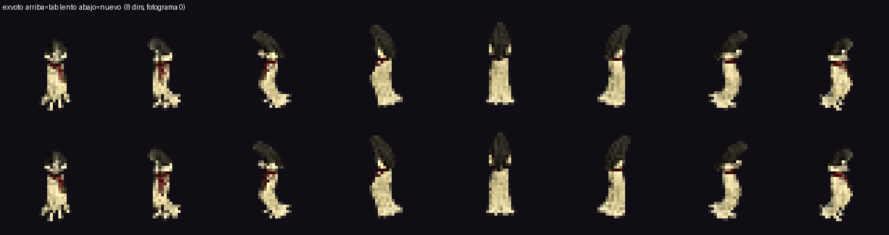

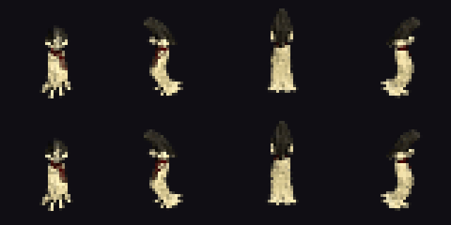

### exvoto_pray_kneel

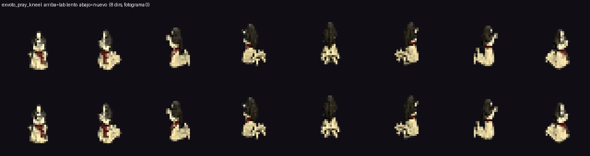

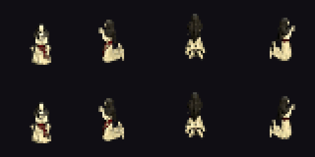

### exvoto_pray_stand

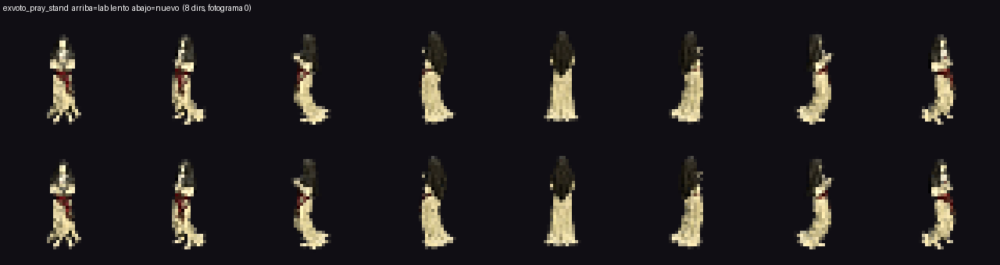

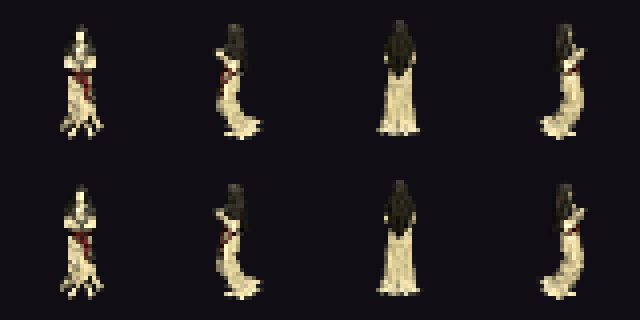

### exvoto_stand_up

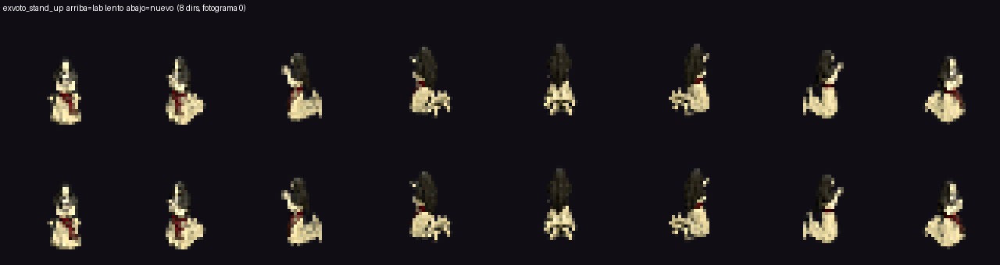

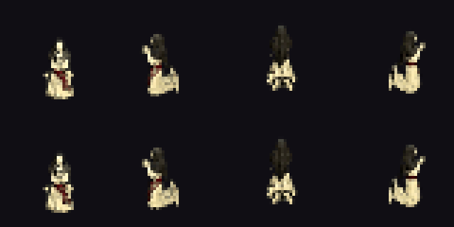

### monaguillo

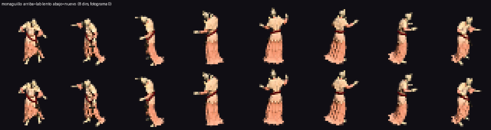

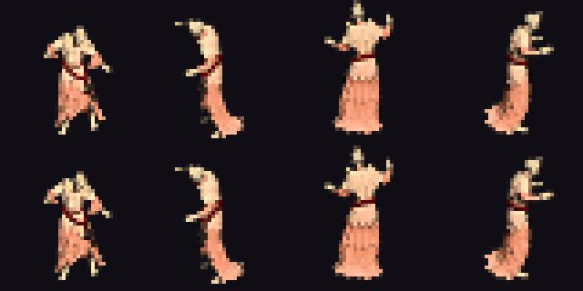

### ojo

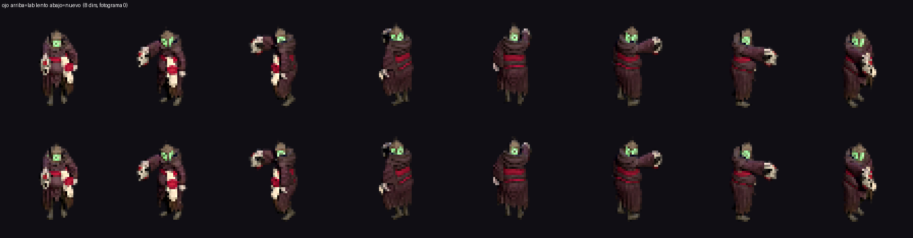

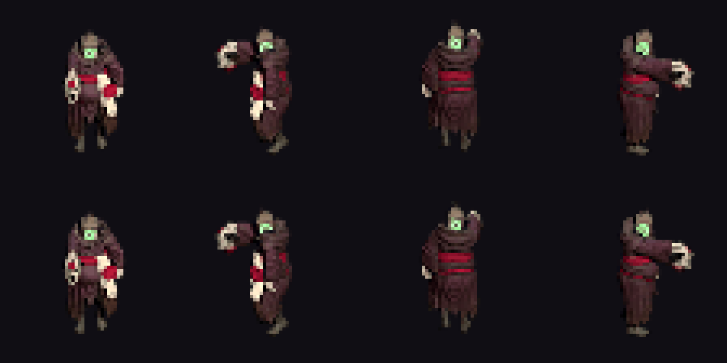

### ojo_look

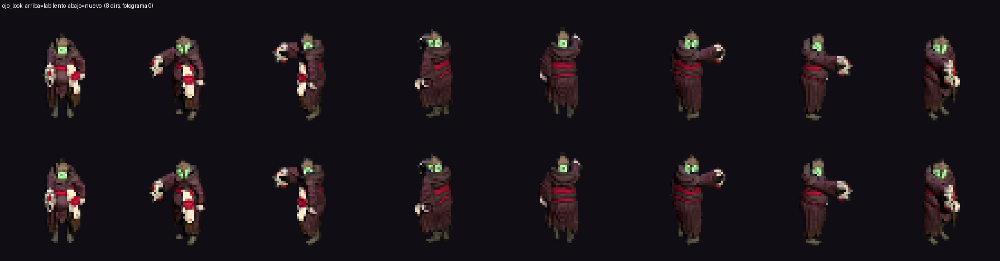

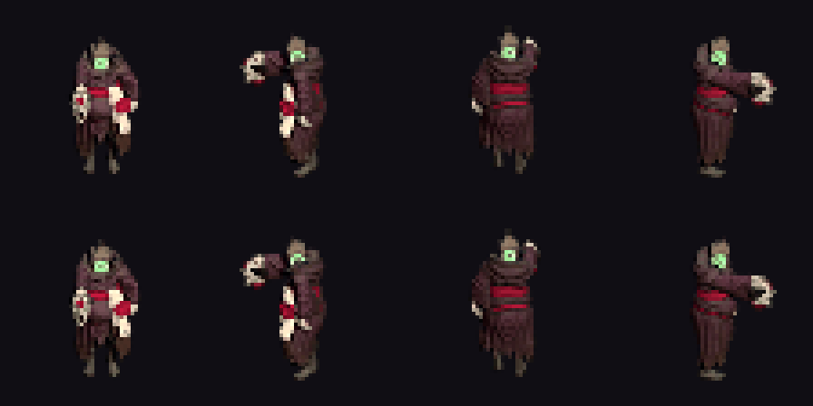

### ojo_sentence

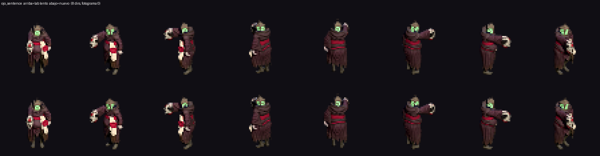

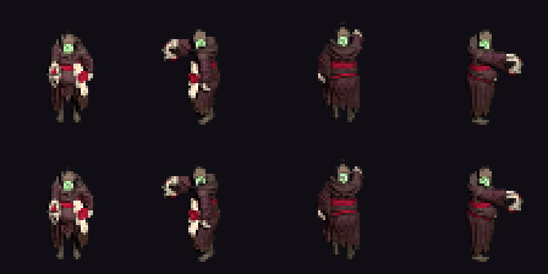

## Diferencias conocidas

- No soporta AgX (`--legibility anterior`), emissiveMap, JPEG embebido, secuencias de GLB ni `--list`: en esos casos llama al exportador lento con aviso. Ningún personaje del manifiesto lo necesita hoy.
- El error de color (3,4–6,7 sobre 255) es ruido en detalle fino de textura; causa no identificada.
- `strideRatio` y `stridePixels` de settings.json difieren ligeramente (campos informativos; no afectan al encuadre ni a `speedFixed8_8`).
- Las máscaras de sombra coinciden (IoU ≈0,98) con un grosor de trazo calibrado empíricamente.
- Props de la catedral y mapas (`prerender_props.py`, `export_map_package_headless.cjs`) siguen con el lab lento.

## Documentos

Sin cerrar: `TECHNICAL.md`, `STATUS.md` y `assets/MANIFEST.md` se actualizarán al fusionar si el usuario aprueba el render rápido.
