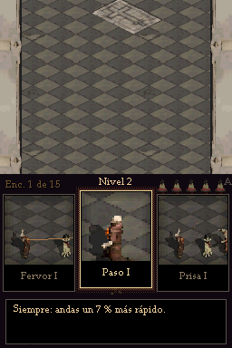
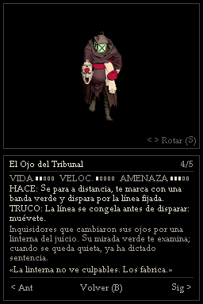

# ROM más ligera: cartas y Códice comprimidos (`perf/rom-compresion`, 2026-11-23)

## Qué cambia

- El arte animado de las 17 cartas de mejora y los retratos de los 5 enemigos del Códice se guardan comprimidos y se descomprimen al cargarlos (al abrir la oferta o al girar el retrato, nunca en combate).
- Mismos píxeles: descomprimir cada bin nuevo devuelve byte a byte el viejo (comprobado en los 22).
- ROM `dungeonds.nds`: **10.454.016 → 9.566.208 B** (−0,9 MB, −8,5 %).

| Carpeta | Antes | Después |
|---|---|---|
| `nitrofiles/levelup` (17) | 1.579.844 B | 804.420 B |
| `nitrofiles/bestiary` (5) | 3.477.053 B | 1.921.120 B |

Formatos y herramientas en `TECHNICAL.md` §3 («Bins comprimidos») y `assets/MANIFEST.md`.

## Verificación

- Build `default` y `cathedral-sandbox`: 0 avisos.
- `bestiary_tour` PASS; los cinco retratos se ven bien.
- Cartas: ningún escenario guardado las muestra (`levelup_cards.json` está obsoleto y enseña el pasillo); se comprobaron con una subida de nivel forzada de usar y tirar.
- Sin mirar en la DS: no toca el dibujado por frame y lee la mitad de datos de la tarjeta.

 

## Estudio de peso de la ROM (antes del cambio)

No hay arte viejo metido en la ROM: todo lo que lleva lo usa el juego. Lo que sobra es espacio sin comprimir. El código pesa 2,3 MB, de ellos ~2 MB de sprites embebidos que además ocupan EWRAM siempre.

| Candidato | Peso | Idea | Ahorro | Riesgo |
|---|---|---|---|---|
| Remates (`nitrofiles/remate/`) | 2,3 MB | Comprimir | ~1,6 MB | Se leen por fotograma en combate: medir en la DS |
| Sombras de personajes | 0,4 MB | De 4 bits a 1 bit (solo usan 0 y 15) | ~0,3 MB ROM y RAM | Toca el blitter |
| Sprites de personajes | 1,7 MB | De BGR555 a paleta de 256 | ~0,85 MB ROM y RAM | Cambio grande; color |
| Cartas y Códice | — | Codificar por diferencias entre fotogramas | Hasta ~0,8 MB más | Bajo |

## MDs

Actualizados `STATUS.md` (la entrega del vídeo 04 pasa a `STATUS-ARCHIVE.md`), `TECHNICAL.md`, `assets/MANIFEST.md` y `walkthroughs/README.md`.
