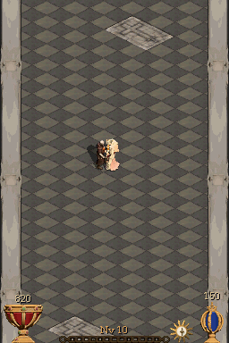
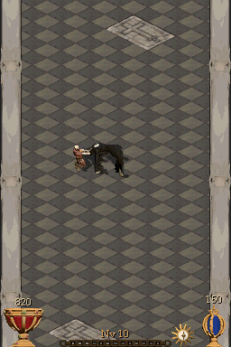

# ROM parcial por contrato

## Qué cambia
Se puede pedir una ROM con solo lo necesario para una prueba: un contrato de conceptos (`golpes remates salas musica monaguillo exvoto parroco smonja ...`). `.ds-game-dev/partial/catalogo.json` traduce cada concepto a archivos de `nitrofiles/`.

```
build-partial-rom.ps1 -ProjectPath <wt> -Variant <v> -Contract <contrato> -Scenarios <escenarios>
```

- La compilación falla si algún archivo de `nitrofiles/` no está en el catálogo.
- Tras compilar corre los escenarios indicados y falla si el juego intenta abrir un archivo que falta (sonda inyectada desde la skill, no parte del juego).

## Verificación
- Contrato `rodaje` (8 escenarios `rodaje_boxeo_*`): PASS, 8,7 MB frente a 56 MB.
- Sin `parroco`/`smonja`: FAIL nombrando los archivos ausentes.
- Probado en la DS por el usuario: funciona, incluidas las salas de párroco y monja.
- Pendiente: el contrato de ejemplo `boxeo-monaguillo` no se ha compilado.

## Evidencia
 

## MDs
Solo `TECHNICAL.md` §3.6c (reescrita). Skill: `references/partial-rom.md`.
