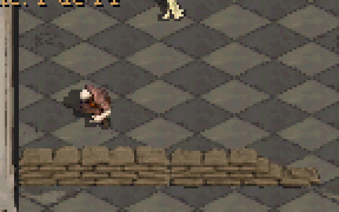
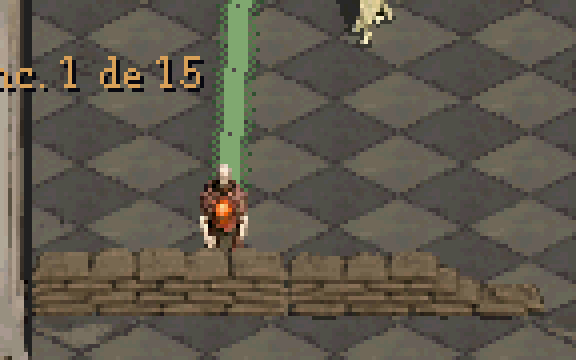
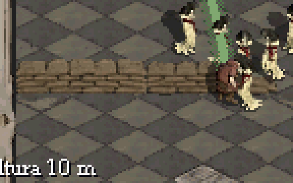
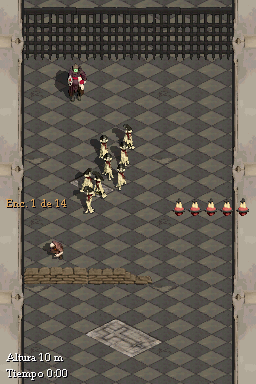
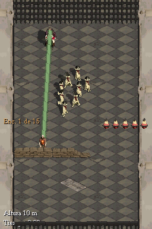
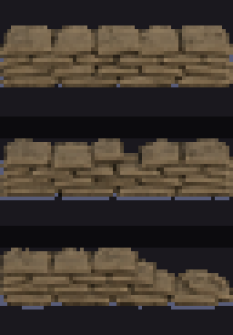

# Huella (hitbox) de las barricadas de sacos

**Fecha:** 2026-11-21
**Rama:** `fix/sacos-hitbox`
**Diseño:** `DESIGN.md` §6.13.6 («Piezas 3D de las salas», sacos)

## Qué estaba mal

La colisión de los sacos del embudo era el rectángulo del **placeholder**, no la huella del arte 3D:

| | rect en el plan | celdas que bloqueaba |
| :--- | :--- | :--- |
| Antes | `{x 0, y 200, w 150, h 24}` | x 0–151, y 200–223 |
| Ahora | `{x 0, y 220, w 128, h 4}` | x 0–127, y 220–223 |

El arte real son dos estampas de 64 px (`sacos` + `sacos_remate_der`) cuya huella horneada desde la
profundidad es una franja de apoyo de 4 px en la base: x 0–128, y 220–224. Con el rect viejo:

- Acercándose **por detrás**, el héroe se detenía 20 px antes de la base del saco: se quedaba de pie
  con un hueco de suelo entre los pies y la barricada (imagen «antes»).
- La colisión se salía ~24 px por el extremo del remate, sobre suelo visualmente libre, y las celdas
  de cobertura baja también se extendían de más.
- La cobertura desde delante (el héroe agachado contra la base) no cambia: el borde inferior sigue
  en 224 y el rect sigue siendo `ENC_R_SACOS` (valor 2, cobertura baja).

Las barricadas de sacos solo existen en la variante **encuentros** (acto I); el compositor de la nave
(strip) no coloca piezas `sacos`.

## Verificación

- **Build `encuentros`:** PASS, 0 avisos (8 s).
- **Escenario nuevo `scenarios/sacos_huella_cobertura.json`:** PASS en la ROM nueva y **FAIL en la ROM
  anterior**, que es lo que debe hacer un test de regresión:
  - de frente (empujando UP contra la base): `hero_y` = 353046 (1379,1 px), agachado = 1;
  - por detrás (tras rodear por el paso derecho): `hero_y` = 350438 (1368,9 px);
  - diferencia entre las dos paradas: 10,2 px (antes 30,2 px: el héroe paraba en 345303, 1348,8 px).
- El escenario queda en la batería con aserciones de estado (`crouched` y el delta de `hero_y`).

## Render: preset y sombra

- **Preset:** el asset guardado es idéntico a un render nuevo del GLB con los ajustes compartidos
  (`tools/props/props_render_settings.json`: legibilidad `c2`, luz `neutral`, cámara 30°). Se
  re-renderizó `sacos` en una carpeta temporal: `color.png`, `footprint.png` y `depth.png` dan el
  mismo sha256; `meta.json` solo difiere en las claves de sombra que añade `prop_shadows.py`.
- **Sombra:** existe (`shadow.png` 64×32, offset 0), horneada con la misma luz clave neutral y
  `shadow_elevation: 45`. Pero en el tramo recto solo quedan **9 px visibles**: el sol, a 45° de la
  vertical, proyecta la sombra de un muro de 17 px justo detrás de él en pantalla, y su propia
  silueta la tapa; solo asoma por los huecos entre sacos. Las piezas hermanas muestran más porque
  tienen más huecos: `sacos_b` 62 px y los remates 31/34 px. No es un problema de preset: es ángulo
  de sol + geometría del muro.

## Archivos

- `tools/encuentros/acto1_v2.json` (rect de sacos y nota de cabecera).
- `source/encounters_act1_tables.h` (regenerado con `tools/encuentros/gen_act1_tables.py`).
- `scenarios/sacos_huella_cobertura.json` (nuevo, en la batería).
- `DESIGN.md` §6.13.6 (la colisión de los sacos es la huella de apoyo del render).
- `tools/bake_cathedral_kit.py` (comentario de `DECOR_PIECES`).

## Evidencia

Antes (ROM anterior): el héroe se queda con un hueco de suelo sobre los sacos.

Después (ROM nueva): los pies quedan metidos tras la fila de sacos.

De frente sigue agachándose contra la base (misma cobertura, mismo borde inferior):

Los fotogramas completos, para ver el encuadre y la cámara:

Sombra horneada del render (azul-gris), de arriba abajo: `sacos` (9 px), `sacos_b` (62 px) y
`sacos_remate_der` (34 px). Es un montaje de los assets del render, no una captura de la ROM.

