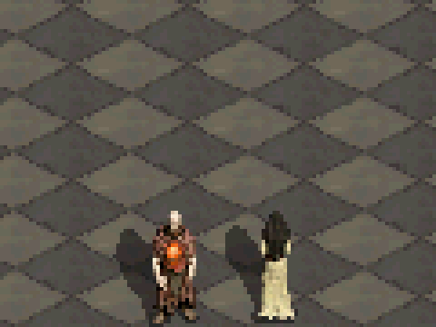
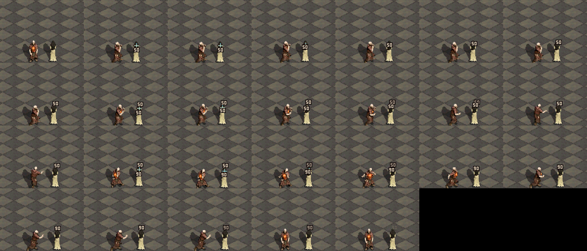
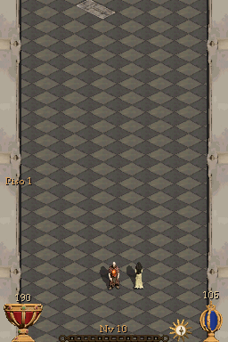
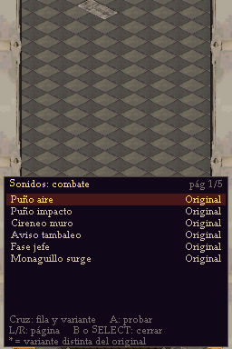
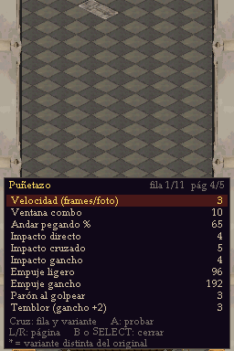
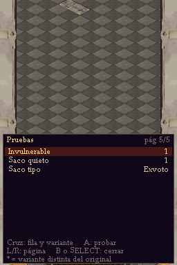

# Sala de boxeo y puñetazo sin cortes

Rama `feat/boxeo-lab` (2026-11-22), sobre `feat/arpg-lab` (menú de ajuste y sonidos) con `fix/punch-pies-puños` (puñetazo andando) fusionado.

## Qué se pedía

Una ROM donde probar cómo se siente el puñetazo: una sala con un solo enemigo de vida infinita, sobre la variante del laboratorio que permite cambiar sonidos, y juntar en ella el trabajo del puñetazo que estaba repartido en dos copias: el puñetazo andando (dar pasos al pegar) y la corrección de la animación cortada (el brazo no llegaba al final).

## Qué se ha hecho

- **Puñetazo andando:** estaba terminado en `fix/punch-pies-puños`; se fusionó tal cual.
- **Brazo que llega al final:** la corrección estaba a medias y sobre código viejo. Se rehízo sobre el actual: una pulsación durante un golpe ya no lo corta; se guarda (hasta 2) y el siguiente golpe sale cuando el brazo ya ha llegado a su punto de impacto. `DESIGN.md` §7.2.
- **Fallos encontrados por el camino:**
  - Los toques cortos se perdían justo después del parón al golpear: había una espera oculta entre golpes. Quitada.
  - El empuje y el aturdimiento del puñetazo no se aplicaban nunca a un enemigo que sobrevivía. Ahora sí.
- **Sala de boxeo (`arpg-boxeo`):** el «saco» aparece a la derecha del héroe, no muere, no se tambalea, vuelve a su sitio tras 1 s sin golpes y el héroe es invulnerable. Se puede cambiar de enemigo y dejarlo quieto o atacando desde el menú. `TECHNICAL.md`, «Variante `arpg-boxeo`».
- **Página «Puñetazo» del menú (SELECT, L/R para cambiar de página):** velocidad, ventana de combo, cuánto anda al pegar, fotograma de impacto de cada golpe, empuje, parón, temblor y alcance. También está en `arpg-lab`.

## Evidencia (ROM real, DeSmuME)

Combo completo con toques cortos: directo, cruzado y gancho (50 + 50 + 90 de daño); el saco retrocede y vuelve.

| Sala | Menú | Página «Puñetazo» | Página «Pruebas» |
| --- | --- | --- | --- |
|  |  |  |  |

## Verificación

- Builds `arpg-boxeo`, `arpg-lab` y `default`: 0 avisos nuevos.
- Escenario `scenarios/arpg_boxeo.json` (fuera de la batería): PASS. Comprueba que el combo de 3 toques cortos quita 190, que el saco retrocede y que tras 40 golpes más sigue vivo.
- **Pendiente:** medir en la DS con `perf` (puñetazo andando y cola de golpes no medidos en la consola).

## Documentos tocados

`DESIGN.md` §7.2 (golpe encadenado), `TECHNICAL.md` (variante `arpg-boxeo`), `STATUS.md`, `walkthroughs/README.md`.
