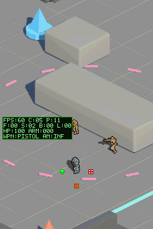
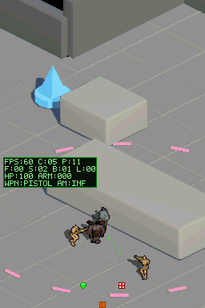
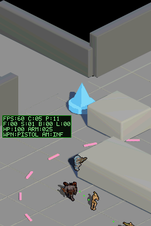
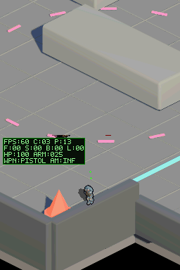
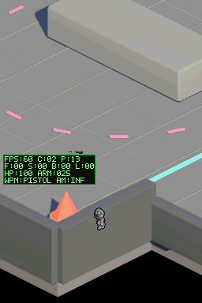

# Saneamiento 2D/3D: proyección, código muerto y repo

Rama `fix/saneamiento-2d3d`. Cierra la deuda de `TECHNICAL.md` §4.1, §4.3 y §4.4 (la §4.2, gameplay preliminar, queda diferida).

## Cambios
- **Suelo isotrópico (2:1):** `GROUND_DY2`/`GROUND_Y_SHIFT` en `gameplay.h`. Velocidad vertical del jugador a la mitad, huella de colisión elíptica 6×3 px, y distancias de persecución/apuntado de enemigos y balas medidas en suelo.
- **Ancla única:** eliminados `PLAYER_ANCHOR_Y` y `CAMERA_ANCHOR_Y`; el culling usa la fila de pies y los chunks de muerte el ancla exportada por personaje/dirección.
- **Oclusión:** resolución 4×4 (2×2 se probó y pierde frames: `vblanks=2`) con reconstrucción exacta en cada movimiento de cámara (antes: histéresis de 4 px). La reducción a bloques de 8×8 ya no asume un factor fijo. El parpadeo del jugador ocluido se mantiene (diseño intencional).
- **Código muerto:** `dungeon_data.c/.h` (-722 KB de ROM: 2.742.784 → 2.003.456 B), lanzas óseas legacy y sus partículas, `enemy_ai_init`, hitscan sin uso, campos `step_*`/`stagger_slot`. `enemy_hit`, `position_is_free`, `bullet_position_is_free` y `sweep_position` pasan a `gameplay.c` (hook de muerte para los chunks); `sweep_position` sin int64; tracers sin truncar.
- **Repo/docs/tests:** 22 escenarios y 9 generadores obsoletos fuera; `HANDOFF.md`, `DESIGN.md`, `STATUS.md` y `TECHNICAL.md` §3 corregidos; test de sombras del lab actualizado al atlas 768×768 y a los nombres actuales del paquete; `test_shadow_masks.py` eliminado.

## Verificación
- Build `DS_BUILD=PASS` sin warnings.
- Escenarios PASS: `map_occlusion_collision_coherence` (recalibrado: frames verticales ×2, 02 con RIGHT 15), `fire_button_contract`, `fire_touch_contract`, `fire_auto_combat`, `room_encounter_test`, `weapons_switching_and_touch`, `bone_dismemberment_preview`.
- Rendimiento (`cpu_ticks` en capturas del escenario de coherencia): media 168.308 / máx 198.348 frente a 173.777 / 193.849 de `main`; `vblanks=1` y HUD en FPS:60. Sin regresión relativa. El umbral absoluto 33514 de `AGENTS.md` no es comparable con esta métrica (valores base ya en el orden de 1,7·10⁵).
- Tests de host: pasan los de contrato; `test_diablo_navigation`, `test_los` y `test_map_export_coherence` no corren sin `numpy`.

## Evidencia

## Pendiente
- Data abort intermitente en hardware (no reproducido en emulador); `crashlog` listo para diagnosticarlo (`CRASHLOG_ENABLED`, desactivado).
Escala personaje/mapa y actores en la pantalla superior (ver `TECHNICAL.md` §4.1); 03/04 deben revisarse visualmente (la oclusión del muro sur no es evidente en 04).
