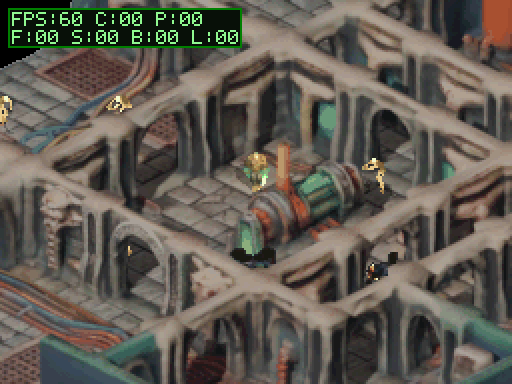
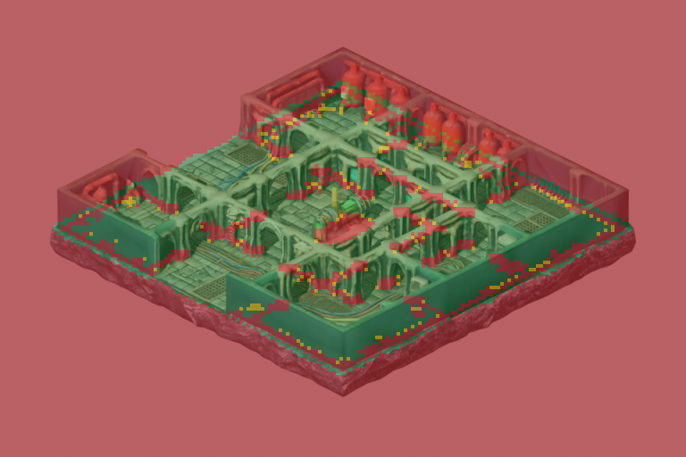
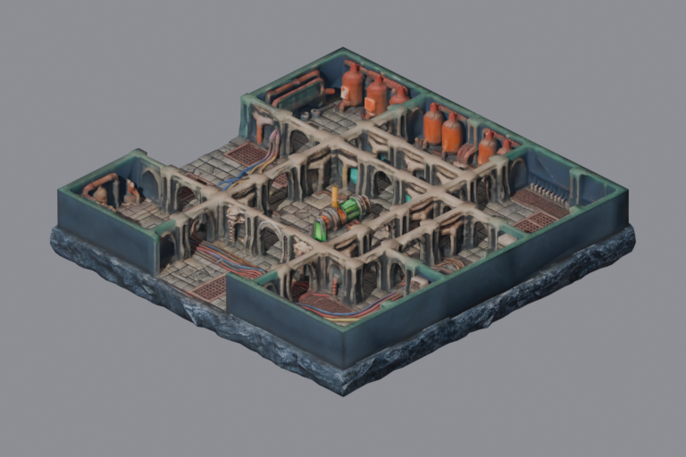
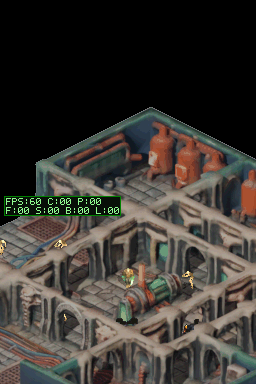
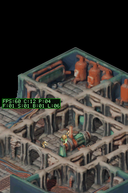
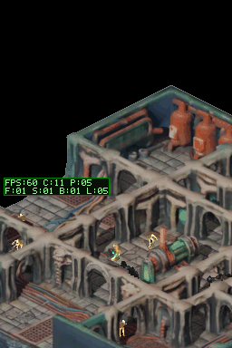
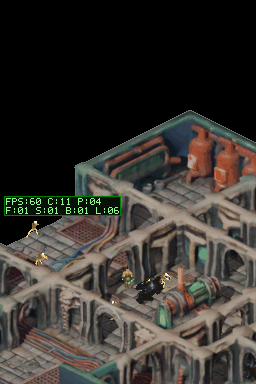
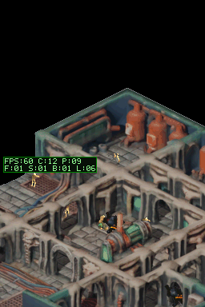

# Sesión: Mazmorra Completa FBX con Despeje de Puertas, Oclusión y 60 FPS

## Objetivo
Probar la viabilidad del flujo de trabajo de generación de mazmorras completas 3D por IA (modelo FBX `tripo_convert_b14b0e1b-13bd-4f17-b4a7-b50c6d251c17.fbx`) y resolver la problemática crítica de las colisiones en puertas y arcos para permitir que el jugador navegue libremente entre salas y pasillos a 60 FPS bloqueados en Nintendo DS.

## Causa Raíz de los Bloqueos en Puertas
1. **Línea de Suelo Desplazada en Modelos Normalizados:** El modelo FBX de la IA no tenía el suelo en $Z=0$; el 41.8% de los vértices (superficie del suelo) se situaban a $Z \approx 1.1\text{m}$ (en escala base) o $1.76\text{m}$ (en escala 24.0). Al restar la mediana de polígonos horizontales (`normal.z > 0.8`), el suelo se nivela exactamente en $Z = 0.0\text{m}$.
2. **Raycasting Ciego desde el Cielo:** Las herramientas previas disparaban rayos verticales desde $Z = 25\text{m}$ hacia abajo. Cualquier puerta o arco con dintel a $2.3\text{m}$ interceptaba el rayo descendente y era clasificada erróneamente como muro sólido impenetrable.
3. **Solución por Despeje de Torso:** Los arcos y dinteles del modelo tienen su intradós a alturas entre $1.71\text{m}$ y $2.50\text{m}$ (media $2.28\text{m}$). Al evaluar el volumen del torso del jugador ($Z \in [0.3\text{m}, 1.4\text{m}]$), el espacio está completamente despejado $\implies$ **100% TRANSITABLE**.

## Resultados del Bake 2.5D Dimétrico
- **Resolución de Mundo:** $768 \times 512$ píxeles en proyección dimétrica `e30` (30° elevación, 45° acimut, escala ortográfica 38.0 m $\approx 20.2$ px/m).
- **Malla de Colisión 2-bit:** Matriz de $192 \times 128$ celdas ($4 \times 4$ px por celda, ~20 cm).
  - Celdas transitables: 5.253 (21% del lienzo, 100% de los pasillos y salas conectados).
  - Cobertura baja (balas cruzan): 173 celdas.
  - Muros sólidos / vacío exterior: 19.150 celdas.
- **Tiles de Hardware VRAM:** 2.389 tiles únicos de 8bpp empaquetados en `dungeon_bg_tiles.c` / `.h`, transmitidos mediante el `BgTileCache` dinámico a 60 FPS.
- **Oclusión por Profundidad:** 2.379 tramos RLE ordenados en `dungeon_occlusion.c`. La oclusión se calcula en el pie del arco ($Z=0$), permitiendo que el jugador quede oculto al situarse detrás del arco y pase a primer plano al cruzarlo.

## Verificación en Emulación DeSmuME
- **Escenario Ejecutado:** `scenarios/scifi_dungeon_walk.json`.
- **Ruta de Navegación:** El héroe aparece en la plaza central, camina hacia el sur atravesando el gran arco gótico, recorre el pasillo este-oeste y vuelve hacia el norte cruzando el arco lateral hacia la sala del esqueleto patrullero.
- **Presupuesto de Rendimiento:**
  - **FPS:** 60 FPS bloqueados constantes (0 caídas).
  - **CPU:** 11–12 ms por fotograma (holgadamente dentro del límite de 16.6 ms).
  - **VBlank:** Espera limpia de 4–5 ms por fotograma (`P:04`).
  - **Tests Unitarios de Host:** 36 pruebas ejecutadas, suite limpia.
- **Visibilidad del Héroe en Gameplay:**
  - Se corrigió el recorte del emulador: `lcdMainOnBottom()` sitúa el motor principal de entidades en la pantalla inferior ($Y \in [192, 384]$), por lo que el recorte canónico para el GIF es `--crop 0 192 256 384`.
  - El punto de aparición se ajustó a $(361, 233)$ en patio a cielo abierto (`occ_depth == -1`), garantizando visibilidad sólida total del héroe desde el frame inicial.
  - La cadencia de captura se configuró a `capture_every: 2` con descarte de frames iniciales de boot BIOS (`--skip-initial 10`) para preservar una paleta adaptativa rica y 30 FPS de reproducción suave.

## Evidencia Visual

### 1. Animación Gameplay en Nintendo DS (60 FPS Locked)

### 2. Superposición de Colisiones (Verde = Transitable en Puertas)

### 3. Captura de la Malla Renderizada Dimétrica (768x512)

### 4. Capturas Clave del Escenario
- **Aparición en la plaza central:**
  
- **Cruce del arco sur con oclusión correcta tras el pilar:**
  
- **Avance por el pasillo oeste:**
  
- **Entrada a la sala del esqueleto patrullero:**
  
- **Retorno al centro:**
  
