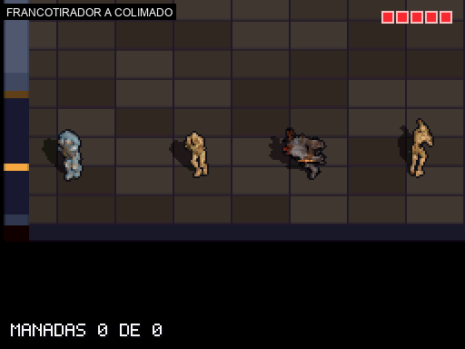

# Colimado del láser del francotirador (2026-11-06, rama `feat/sniper-collimation`)

Mientras se carga el disparo, el láser de los estilos A/B/C se **colima**: empieza ancho, difuso y rojo, y se estrecha hasta quedar en 1 px verde y estable cuando el disparo está listo. Decisión en `DESIGN.md` §4.9 (elegida por el usuario tras ver mockups: A1, B3, C1).

## Qué se hizo
- `source/weapons.c`: `s_aim_prog` (0..256, una división por frame en `weapons_input`), color nuevo `FX_AIM_DIM` y `render_aim_line` reescrita: A banda tramada que se cierra, B nube de puntos por hash (tope 128) que se disipa, C halo tramado que se afina hacia el retículo. Sin `float`, bucles con tope, sin parpadeo al quedar listo.
- `tests/test_weapons_contract.py`: 4 tests de contrato (progreso, sin `float` ni `/` `%`, tope de la nube, umbral del color).
- `tools/sandbox_scenes.py` y `tools/sandbox_gifs.py`: escenarios `sandbox_sniper_collim_{A,B,C}` (carga con una captura por frame, listo, disparo); `tools/collim_contact_sheet.py` genera las hojas de contacto.

## Evidencia (ROM real, DeSmuME)
Los mockups de la fase de elección están marcados como tales en `assets/mockup_colimado_*.png`.

| A | B | C |
| --- | --- | --- |
|  |  |  |

Hojas de contacto ampliadas 4x (frames 0, 4, 8, 12, 16, 20, 24, 30 de la carga): [A](assets/contact_collim_A.png), [B](assets/contact_collim_B.png), [C](assets/contact_collim_C.png). El láser pasa a verde hacia el frame 18 (70 %) y a 1 px en el 24 (`aim_min_frames`).

## Verificación
- Tests de host: `test_weapons_contract` (42), `test_sandbox_contract` (12), `test_gameplay_contract` (9) OK. `test_enemy_fsm` no existe en el repo (ya estaba referenciado en `.ds-game-dev/project.json`, no es de este cambio).
- Compilación: 0 warnings. Escenarios `sandbox_sniper_collim_*` PASS.
- **Pendiente:** 60 FPS en la DS con `playground-perf` (regla 6); no certificado.
