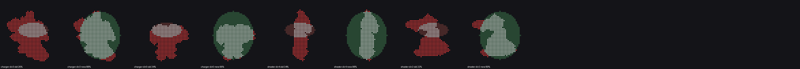

# Francotirador: el rayo acierta en todo el sprite (rama `fix/sniper-hit-side`)

## Problema
El rayo casi no contaba como impacto al entrar de lado a un enemigo que mira al sur; solo acertaba con el puntero en el centro del sprite.

## Causa (medida)
- El rayo vuela a la altura del cañón (18 px) y el puntero se lee en pantalla (`MUZZLE_H`), pero el impacto se probaba contra la **elipse de suelo** del enemigo (`ENEMY_HIT_RADIUS` = 11 px, semieje vertical 5,5 px) centrada en los pies, sin tener en cuenta la altura del cuerpo.
- Resultado: solo acertaban los puntos del puntero a 13-23 px sobre los pies (11 filas de unas 38 del sprite).
- Cobertura de los píxeles opacos del sprite (8 direcciones, 8 frames, `tests/test_sniper_hit_volume.py`): **22-39 %** antes, **88-98 %** ahora (cargador y tirador, alturas de cañón 14/18/22).

Evidencia: [`assets/hit_volume_old_vs_new.png`](assets/hit_volume_old_vs_new.png). Gris = píxel del sprite dentro del volumen; rojo = píxel del sprite fuera; verde/marrón = volumen nuevo/viejo.

## Arreglo
`include/hitvolume.h`: `body_hit_test(dx, dy, h)` prueba el punto del rayo en espacio de pantalla contra una elipse de cuerpo (centro 14 px sobre los pies, semiejes 15 × 18; caja opaca medida de los sprites: ~30 px de ancho, de -6 a +33 px sobre los pies). Solo enteros, sin `float`, 3 multiplicaciones por enemigo y paso (como antes). Lo usan `fire_sniper` y `update_aim_target` (retícula del estilo C).

## Escopeta y granada
- **Granada:** daño de área en suelo con radio en elipse 2:1; apuntas al suelo, no se ve afectada.
- **Escopeta:** los perdigones tienen la misma limitación (elipse de suelo, ignoran la altura). No se toca: el abanico de perdigones lo compensa y cambiarlo mueve el equilibrio de daño; anotado en `TECHNICAL.md` §3.4.

## Verificación
- Test de host `tests/test_sniper_hit_volume.py` (4 tests): cobertura, fallos lejanos, barrido por columnas, sin `float`.
- Escenarios `sniper_hit_sweep_west/east` (`tools/sandbox_scenes.py`): tirador parado mirando al sur (ordinal 0 del sandbox = `DIR_SOUTH`), héroe 70 px a la izquierda o la derecha, puntero a 11 alturas sobre los pies; el rayo cruza de verdad el sprite (regla 5). Lee `g_enemies[0].hp`. **Con la fórmula vieja FALLAN** (`up4, up8, up12, up28` no matan) y **con la nueva PASAN** los dos.
- Compilación `default` y `sandbox`: 0 warnings. Tests de host: 7 de 8 PASS; `test_enemy_fsm.py` figura en `project.json` pero el archivo no existe en el repo (previo a esta rama).
- `s_enemies` de `main.c` pasó a global `g_enemies` (ambigüedad con el `s_enemies` de los datos de arena al leerlo por símbolo); contratos de texto actualizados.

## Pendiente
Validación en la DS (regla 6) con `playground-perf`: no medida aún.
