# Tipografía: Palatino nítida en todo el juego (2026-11-19)

Sesión `feat/tipografia`. Se estudió la legibilidad de las fuentes, se eligió Palatino con trazado nítido y se llevó a todo el texto del juego salvo el contador de rendimiento. Además se arregló el menú de título, que la ROM jugable se saltaba.

## Qué se hizo

- **Causa de la mala lectura:** la fuente del Códice era Georgia a 11 px dibujada suave y recortada a blanco y negro, lo que rompe los trazos finos. Se usa ahora el trazado con hinting de la propia fuente.
- **Elegida:** Palatino 11 px nítida (misma altura y hueco que antes). Georgia nítida se lee bien pero es más ancha y desborda las fichas con datos. Rondas A/B/C: `assets/tipografia_ronda1.html` y `assets/tipografia_ronda2.html`.
- **Fila VIDA, VELOC., AMENAZA:** marcas de 3 px con paso 5 para que quepa con la fuente nueva.
- **Menú, pausa, controles y HUD de partida:** dejan la fuente de 5×7 solo en mayúsculas y pasan a Palatino con tildes y minúsculas.
- **Pedestales antiguos (`modifiers.c`):** nombres con tildes ("Cañón largo", "Recámara doble").
- **Título:** el salto del menú venía de la variante de encuentros. Ahora solo las variantes de pruebas (`SKIP_TITLE`) arrancan directas; la ROM jugable muestra el título.
- **Fuera de alcance:** contador de FPS y datos de rendimiento (siguen en 5×7).

## Antes y después

Cada pareja: izquierda ANTES (`d65c39d` con solo el arreglo del título), derecha DESPUÉS. Capturas reales de la pantalla inferior de la ROM, 256×192.

### Menú de título

| Antes | Después |
| :---: | :---: |
| 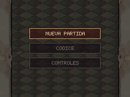 | 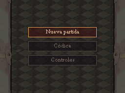 |

Vuelve a aparecer al arrancar (antes la ROM entraba directa en partida). Botones en Palatino, con minúscula inicial. La pantalla superior no lleva logo en ninguna de las dos versiones.

### Pausa

| Antes | Después |
| :---: | :---: |
| 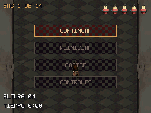 | 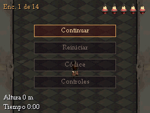 |

Los cuatro botones caben y quedan centrados. El gris de los botones inactivos pierde algo de contraste con la letra fina.

### Controles

| Antes | Después |
| :---: | :---: |
| 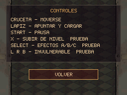 | 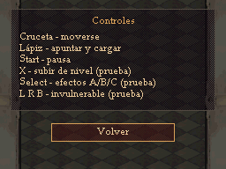 |

El mayor salto: tildes y minúsculas ("Lápiz - apuntar y cargar", "subir de nivel (prueba)").

### Códice: El Corazón Abierto

| Antes | Después |
| :---: | :---: |
| 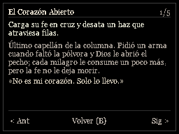 | 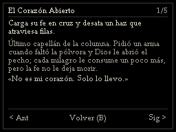 |

Misma ficha; las letras se leen más limpias y la "a", la "e" y la "m" ya no se pegan.

### Códice: El Exvoto (con datos)

| Antes | Después |
| :---: | :---: |
| 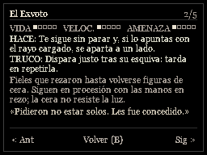 | 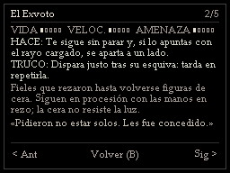 |

La fila VIDA, VELOC. y AMENAZA cabe en el marco con las marcas más juntas. Queda en un gris algo más tenue que el resto.

### Códice: El Abanderado (la más cargada)

| Antes | Después |
| :---: | :---: |
| 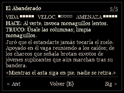 | 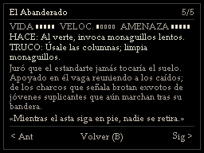 |

Cabe entera sin tocar los botones de abajo.

### Introducción 1/4: La catedral

| Antes | Después |
| :---: | :---: |
| 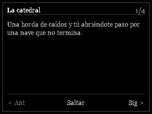 | 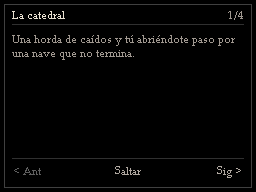 |

Sin cortes.

### Introducción 2/4: Moverse y apuntar

| Antes | Después |
| :---: | :---: |
| 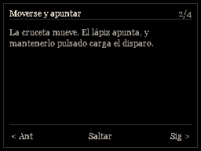 | 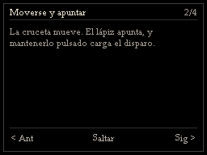 |

Sin cortes.

### Introducción 3/4: La marea

| Antes | Después |
| :---: | :---: |
| 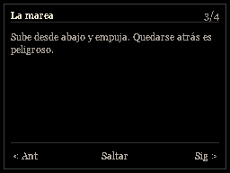 | 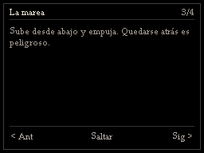 |

Sin cortes.

### Introducción 4/4: Vida

| Antes | Después |
| :---: | :---: |
| 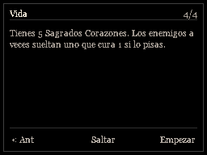 | 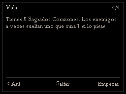 |

Sin cortes; el texto se reparte distinto entre líneas. El HUD de la pantalla superior va horneado en el vídeo y sigue con la letra antigua.

### HUD en partida

| Antes | Después |
| :---: | :---: |
| 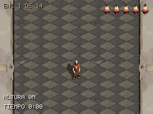 | 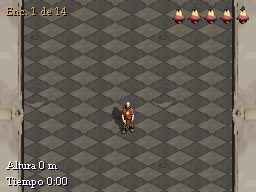 |

La parte más discutible: "Enc. 1 de 14", "Altura 0 m" y "Tiempo 0:00" salen más finos y se leen con menos fuerza sobre el suelo con textura. Mejora la ortografía, pierde contundencia.

### Subida de nivel: dones

| Antes | Después |
| :---: | :---: |
| 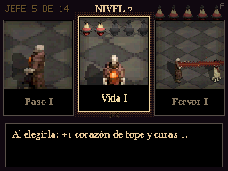 | 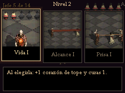 |

Ya usaba la fuente del Códice, ahora en Palatino. Las cartas ofrecidas cambian por azar. El texto "Jefe 5 de 14" queda en parte tapado por la carta seleccionada.

### Subida de nivel: reliquia

| Antes | Después |
| :---: | :---: |
| 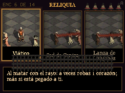 | 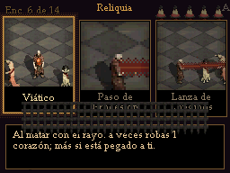 |

Texto del efecto correcto. La reja de la sala se dibuja encima de las cartas en las dos versiones, así que no se puede comprobar si los nombres largos caben en dos líneas.

### Jefe: introducción

| Antes | Después |
| :---: | :---: |
| 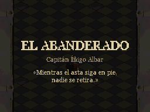 | 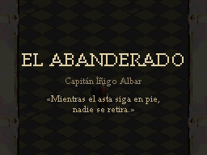 |

Nombre, capitán y cita con Palatino; el título es más fino y claro.

### Jefe: victoria

| Antes | Después |
| :---: | :---: |
| 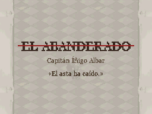 | 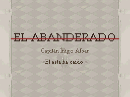 |

Sin cortes.

### Jefe: HUD en combate

| Antes | Después |
| :---: | :---: |
| 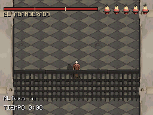 | 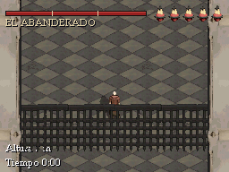 |

La reja tapa parte de "Altura" y "Tiempo" en ambas versiones; no es de la tipografía.

## Pendiente

- Escribir la decisión en `DESIGN.md` (Palatino en todo el texto, HUD incluido).
- Subir el contraste de los botones inactivos y de la fila de datos del Códice.
- Medir rendimiento en la DS con la variante `perf` (el cambio toca el dibujado de texto por frame en el HUD).
- Sin cubrir: pedestal con nombre y pantalla "Mazmorra completada" (el HUD de pedestales solo existe en la rama no-encuentros), reja que tapa nombres de reliquias, y `Jefe 5 de 14` tapado por la carta seleccionada.
- Validación en la DS física: ROM subida el 2026-11-19 (sin el cambio de los nombres de pedestales).
