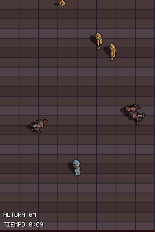
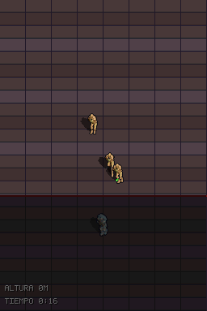
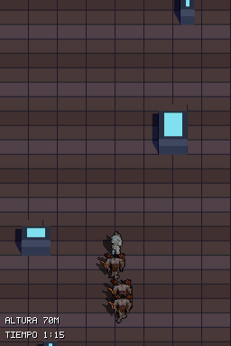

# v0.3 mínima: franja vertical infinita, horda desde arriba y marea (2026-11-06)

Rama `feat/v03-minima`. Primer paso jugable de la dirección survivors (`DESIGN.md` §6.0): el juego que ya había (armas, cargador, tirador, vida e i-frames) en un escenario vertical infinito. Sin gemas, mejoras, élites ni jefes.

## Qué hay
- **Mapa infinito de 512 px de ancho** generado en tiempo de ejecución (`source/strip.c`). Una `Arena` en RAM de 512x2048 px es una ventana de la franja. Cada banda de 128 px se genera con un hash de (semilla, banda): suelo cian con muros laterales y de 0 a 3 columnas bajas. Siempre queda libre un carril de 64 px que se desplaza como mucho 8 px por banda. Cuando el jugador sube, la ventana baja 512 px (rebase), se generan 4 bandas nuevas arriba y `strip_shift_world_y` desplaza toda coordenada Y viva. El resto del motor sigue leyendo `g_arena` como antes.
- **Kit de arte** (`source/strip_kit.c`, 89 tiles) horneado con el lab a partir de las piezas de la mazmorra v0.2: spec en `assets/arenas/arenas.json` → `kits`, baker en `tools/bake_strip_kit.py`. Columnas de 0,5 m que paran a los personajes pero no las balas y no ocluyen.
- **Horda** (`source/horde.c`): nace por encima de la pantalla superior y baja hacia el jugador. El intervalo de aparición baja y el tope de vivos sube con el tiempo (pool de 24). Los enemigos que quedan atrás o se traga la marea se reciclan sin recompensa.
- **Marea** (`source/tide.c`): línea que sube a 0,35 px/frame. Dentro, el jugador va a media velocidad y recibe un golpe cada 75 frames. Se pinta con WIN0 y fundido a negro por hardware, sin coste de CPU, más un borde rojizo de 2 px.
- **Curas** (`source/pickups.c`): 1/12 por muerte, máximo 4, se recogen pisándolas.
- **HUD:** altura en metros y tiempo. Al morir, resumen con la mejor marca de la sesión y reinicio con semilla nueva. La primera semilla sale del reloj de la DS.
- **Navegación** ampliada a 48x128 nodos; en el rebase se desplaza el campo en vez de rehacerlo.
- Todas las cifras de juego están marcadas `[TUNABLE-PLACEHOLDER]` en `include/horde.h`, `tide.h` y `pickups.h`.

## Evidencia (ROM real en DeSmuME)
| Horda llegando por arriba (frame 600) | Marea sobre el jugador y resumen de muerte (frame 1000) | Subida con god mode: 70 m, 4 rebases |
| :---: | :---: | :---: |
|  |  |  |

- `strip_climb_smoke`: en 4500 frames subiendo se recorren 2852 px y se acumulan 2048 px de rebase. Las aserciones leen `g_strip_debug`, no la Y dentro de la ventana.
- `strip_horde_tide`: con el jugador quieto, a los 600 frames hay 6 enemigos vivos y a los 1000 la vida ha bajado de 5 a 0.

## Rendimiento en la DS (`PERF_PROFILE`, variante `perf`)
Último arranque del log (52 s de partida, 3120 frames):
- **CPU:** media de 219.000 ticks (39 % de 560.190) y máximo de 489.882 (87 %). Ningún frame pasa del presupuesto por trabajo propio.
- **Frames con más de un vblank:** 31, exactamente uno por ventana de 60 frames. Son la escritura del log en la SD (`sdw_ticks` de 1,0 a 1,6 M por ventana), es decir, coste del propio perfilado. Descontándolos, 0.
- **Tramos:**
  - `en`: media de 53.000 y máximo de 115.000.
  - `blit`: media de 30.000.
  - `sh`: media de 63.000.
  - `proj`: máximo de 106.000; es el pico a vigilar.
  - Reconstrucción del BG en el frame del rebase: máximo de 61.000.
- El usuario la jugó y dice que, en rendimiento y jugabilidad, "por primera vez se siente como un juego real". Quedan por pulir las cifras y los assets.
- **Límites de la medición:** el log del FTP se acumula entre sesiones y no se borró, y solo el último arranque (52 s) es seguro de esta ROM. El pool sigue en 24 enemigos, por debajo del criterio de `TECHNICAL.md` §4.7 (32 visibles, 48 activos).

## Revisión
Sonnet revisó el diff y encontró 12 bugs de lógica, todos corregidos:
- Navegación ciega unos 30 frames en cada rebase.
- Curas viejas que bloqueaban los drops.
- La marea perdía golpes con i-frames.
- La pantalla de muerte se saltaba con el stylus pulsado.
- La rama del tirador afectaba a la v0.2.
- Costura del carril en el rebase.
- Bandas despejadas en el sitio equivocado.
- Grupos de spawn mal colocados.
- Slots reciclados sucios.
- Semilla fija.
- División por nodo.
- Puntero nulo con un kit inválido.

No encontró estado Y sin desplazar ni desbordes. El arreglo de la semilla que propuso el agente pausaba el juego hasta la primera pulsación (comportamiento no decidido, regla 9) y se sustituyó por el RTC.

## Agentes
- **Kit, generador, integración, bucle y arreglos:** luna:high (Codex) mediante `delegate-agents`.
- **Revisión:** Sonnet.
- **Coordinación, decisiones y verificación:** Opus.

Los agentes Codex no pueden arrancar Python, Docker ni WSL en su sandbox, así que el render del lab, la compilación, los tests y los escenarios se ejecutaron desde la sesión principal.

## Pendiente
- Ajustar cifras y assets jugando.
- Los escenarios `dungeon_pack_*` pasan en vacío con la ROM por defecto (ya no hay manadas): borrarlos o moverlos a una variante de la mazmorra.
- Borrar `/dungeonds_perf.log` de la DS antes de la próxima medición, para no mezclar sesiones.
