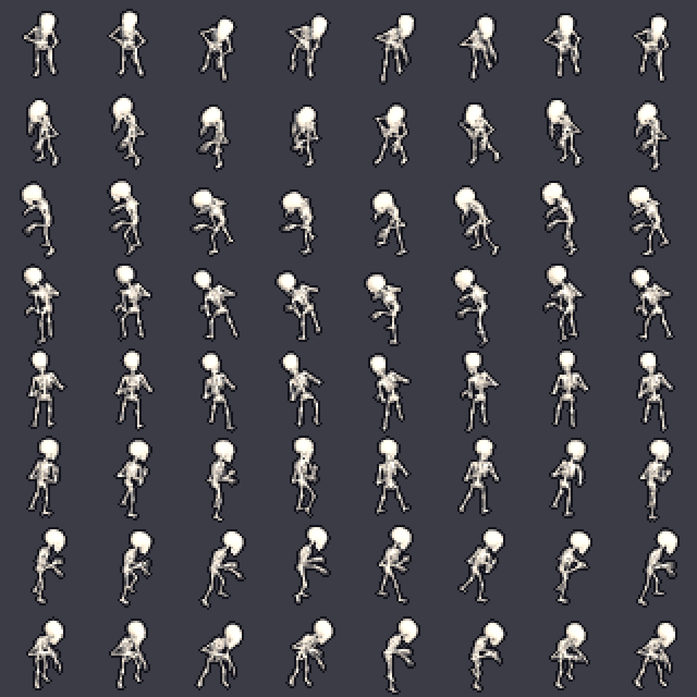
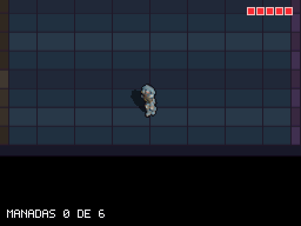
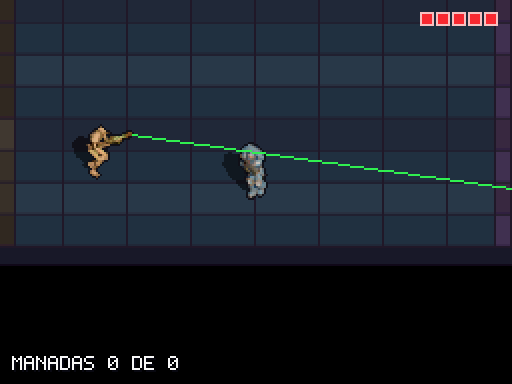
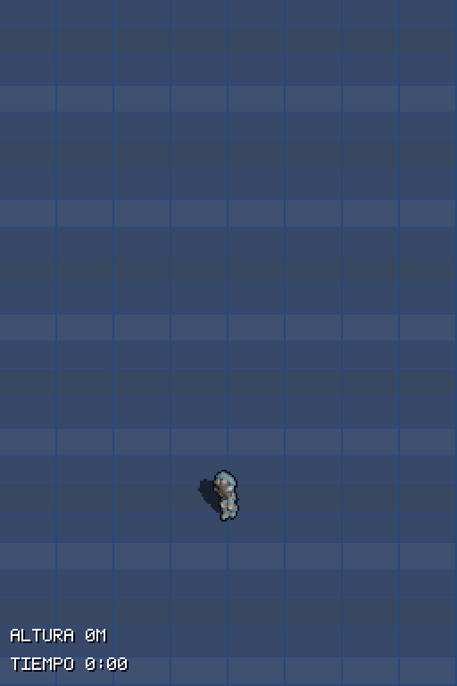
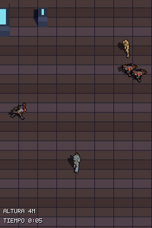
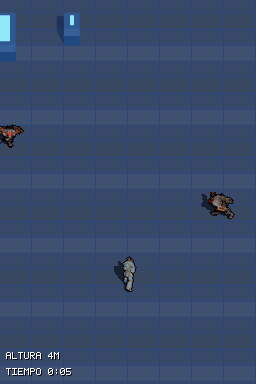
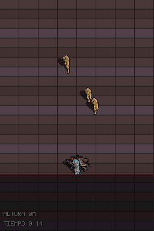
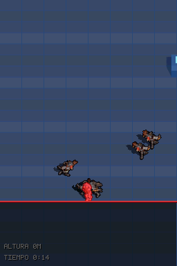

# v0.3.1: tres tiers de enemigos, escala de cifras y pulido

**Estado (2026-11-07): cerrada.** Implementado y validado en DeSmuME y en host, subido a la DS y jugado por el usuario: el rendimiento le pareció bien y el juego se siente mucho mejor. No se midió con `PERF_PROFILE` ni se subió el techo de la horda (siguen en "Pendiente"). Rama `feat/v031-tuning`, fusionada en `main`. Siguiente: 0.3.2 y 0.3.3, dirección de arte (`DESIGN.md` §6.9.1b).

Todas las imágenes y GIFs son capturas de la ROM real en DeSmuME. Los de enemigos salen de la ROM *sandbox* (enemigos colocados a mano y escenas con geometría exacta, `AGENTS.md` regla 5). El de la horda sale de la ROM normal.

## Por qué esta versión

Tras jugar la 0.3 mínima en la DS:

- El **cargador** era injusto: 60 de vida, 90 % de la velocidad del héroe y el 75 % de la horda. Durante 10–15 s se podía mantener a raya y luego se acumulaba y sobrepasaba.
- El **tirador** no amenazaba: proyectiles lentos que se esquivaban sin pensar y frágil.
- Faltaba un enemigo barato del que hubiera muchos.

La decisión está escrita en `DESIGN.md` §6.9.1 ("Enemigos de la 0.3.1"). Es más de lo que decía el alcance original (tuning sin mecánicas nuevas): se aprobó adelantar el "enjambre" de §6.7 y rehacer los dos enemigos existentes.

## Cómo queda el juego

### Escala de cifras: 100 = 1,0

Vida y daño son enteros en centésimas (sin `float` en la DS), de modo que una mejora de +20 % es 100 → 120. Todo el daño de armas se multiplicó por 5 y se mantuvieron las proporciones de antes.

| Cifra | Antes (0.3 mínima) | Ahora (0.3.1) |
| :--- | :--- | :--- |
| Vida del cargador | 60 | 300 |
| Vida del tirador | 20 | 200 |
| Vida del esqueleto | no existía | 100 |
| Francotirador, daño por disparo | 30 | 150 |
| Escopeta, daño por perdigón (5 perdigones) | 8 | 40 (200 por disparo) |
| Granada, centro | 60 | 300 |
| Granada, borde | 15 | 75 |
| Vida del jugador | 5 golpes | 5 golpes (sin cambio) |

Con esto el francotirador mata al esqueleto de 1 disparo y al tirador y al cargador de 2; la escopeta a quemarropa, al esqueleto de 1 y al cargador de 2.

### Los tres tiers

| Tier | Papel | Vida | Velocidad (héroe = 326) | Peso en la horda |
| :--- | :--- | :--- | :--- | :--- |
| **Esqueleto** (modelo nuevo) | Masa lenta que muere de un toque; persigue y muerde | 100 | 130 | 60 % (antes: el cargador, 75 %) |
| **Cargador** | Amenaza rara y rápida | 300 | 150 al acercarse, 650 al cargar | 15 %, máx. 3 vivos |
| **Tirador** | Amenaza a distancia con láser | 200 | 180 | 25 %, máx. 2 láseres cargando a la vez |

Todos los números siguen marcados `[TUNABLE-PLACEHOLDER]` para ajustarlos jugando.

### Esqueleto

Renderizado a partir del FBX que dejaste en el inbox (rig y animación de caminar de 2,92 s) con el lab en modo headless, en 8 direcciones × 8 frames de 40×40. Se añadió `tools/lab/export_character_headless.cjs`, que antes no existía para personajes. Añade unos 400 KB a la ROM. El cráneo sale algo quemado a blanco y sin detalle facial; es mejorable en el modelo o con otra luz.

### Cargador: cargar y esquivar

Ya no es un esqueleto con más números. Ahora tiene su propia máquina de estados:

1. **Acercamiento** lento hasta tener línea de visión a menos de ~160 px.
2. **Telegrafía** de 30 frames: se queda quieto, el sprite parpadea y fija la dirección hacia el jugador.
3. **Carga** en línea recta a 650 durante ~160 px. Un golpe si toca al jugador (respeta los i-frames).
4. **Recuperación** de ~60 frames, vulnerable.

Si choca contra un muro o una columna queda **aturdido** 90 frames. Un golpe de escopeta o una explosión de granada durante la telegrafía o la carga lo aturde 60 frames (decidido el 2026-11-07). El francotirador no aturde.

En el GIF, la telegrafía se ve como el sprite desapareciendo a intervalos (solo queda la sombra), luego la carga y el golpe, con el héroe en rojo. Para que la telegrafía cupiera en pantalla, la copia del escenario usada para el GIF coloca al cargador más cerca de la cámara que el escenario de pruebas.

**Lo que este GIF no demuestra:** el escenario de pruebas sí comprueba que, al chocar contra la columna, el estado pasa a aturdido (`enemy_charger_charge_into_column_stuns`, PASS). Pero en las capturas el aturdimiento **no se distingue**: el cargador se ve parado, sin marca visual. Es un hueco de legibilidad real: si el jugador no ve que está aturdido, no sabe que es el momento de atacarlo. Queda anotado como decisión pendiente (abajo).

### Tirador: esquivar la carga del láser

Sustituye a las ráfagas de proyectiles (que se han borrado, `source/projectiles.c` incluido):

1. **Posicionarse** en su banda de distancia.
2. **Carga** de 40 frames: línea verde fina que sigue al jugador.
3. **Fijado** de 20 frames: la línea deja de girar y se ensancha.
4. **Disparo** de 8 frames: el rayo hace 1 golpe si el jugador está en la línea.
5. **Enfriamiento** de 90 frames.

El rayo no se detiene en columnas, igual que las balas. Dibujo en `source/enemy_laser.c`, con el mismo método que el láser del jugador, en verde, con bucle de tope fijo (320 pasos). Un empujón de escopeta cancela el láser.

Lo que se ve de verdad: la línea fina verde, el haz ancho del disparo (verde muy claro, casi blanco) y, en el primero, el héroe en rojo y un corazón menos. En el segundo, el héroe sale de la línea y la vida no baja. **Limitación:** el primer GIF no muestra bien la secuencia fina → fijada → disparo en un solo ciclo, y el segundo empieza ya con la línea fijada. Los escenarios (`enemy_shooter_laser_hits_standing_player` y `enemy_shooter_laser_dodged_by_leaving_line`, PASS) sí comprueban la diferencia de resultado con la misma escena.

### Horda y marea

La horda baja desde arriba con el nuevo reparto (mayoría de esqueletos) mientras la marea sube. Dos pantallas apiladas, ~16 s de juego a ~1,9× de velocidad.

## Pulido de assets

### Suelo y columnas

El lab renderizaba el kit de la franja con el preset de luz *cálida*, que convertía el suelo azul pizarra en marrón-malva y hacía que el acento cian no se leyera. Ahora el kit usa luz neutra (clave 1,4, relleno 1,0, mundo 0,5) y la zona cian es algo más oscura (`shade` 1,0 → 0,7; con 0,5 las columnas se fundían con el suelo). `tools/export_arenas.py` admite ahora luz por arena o kit; las arenas de la mazmorra no cambian. El kit pasa de 89 a 90 tiles (presupuesto 400).

| Antes | Después |
| :---: | :---: |
|  |  |

Valoración honesta: el suelo ya no es marrón y los enemigos (naranja y marrón) y las columnas con tapa cian se leen claramente mejor. Pero el suelo es azul pizarra, no un cian claro, y el cuerpo de las columnas sigue parecido al suelo. Es una mejora clara, no un problema resuelto.

### Borde de la marea

La banda roja de 2 px quedaba dentro de la zona que oscurece el fundido a negro y casi desaparecía. Ahora la ventana del fundido empieza justo por debajo de la banda, que sube a 3 px con degradado de color (`(31,8,8)` → `(20,3,4)` → `(10,1,2)`). Sin coste de CPU por píxel: solo cambia el registro de la ventana.

| Antes | Después |
| :---: | :---: |
|  |  |

## Limpieza

- Los escenarios `dungeon_pack_*` pasaban en vacío desde que la ROM principal es la franja. **No se borraron:** están en `scenarios_legacy/dungeon_v02/` con un README, fuera de `scenarioDirectory`, hasta que haya una variante de la ROM que arranque la mazmorra.
- `sniper_hit_sweep_east` y `sniper_hit_sweep_west` usaban un tirador como diana; ahora usan un esqueleto (el tirador ya no muere de 1 disparo).
- Eliminado `source/projectiles.c` y `include/projectiles.h`: ya nada dispara proyectiles enemigos.
- Se añadieron `_Static_assert` del layout de `Enemy` (84 bytes) y de `PlayerState`, porque los escenarios leen esos structs por offset.

## Validación

| Comprobación | Resultado |
| :--- | :--- |
| Build ROM por defecto y sandbox | `warnings=0`, `new_warnings=0` |
| Tests de host (`python -m unittest discover -s tests -p "test_*.py"`) | 172 OK (sin `-I`: ese modo oculta numpy y hace fallar 6 módulos) |
| `strip_climb_smoke`, `strip_horde_tide` | PASS |
| `enemy_*` nuevos (6) | PASS |
| `sniper_hit_sweep_east` / `west` | PASS |
| Revisión del diff con Luna:high | 1 error real arreglado (la orientación del cargador y el tirador se clasificaba mal en diagonales); 2 avisos de divisiones `/` por frame, pendientes de medir |
| Medición en la DS (`PERF_PROFILE`) | **No hecha** |

Seis escenarios nuevos (sandbox, geometría real): `enemy_sniper_row_skeleton_dies_in_one_shot`, `enemy_charger_lunge_hits_player`, `enemy_charger_charge_into_column_stuns`, `enemy_charger_shotgun_stuns_telegraph`, `enemy_shooter_laser_hits_standing_player`, `enemy_shooter_laser_dodged_by_leaving_line`.

## Pendiente y decisiones abiertas

**De esta versión, sin hacer:**
- **Medir en la DS** con `PERF_PROFILE 1` (regla 6), sobre todo el coste de los láseres con la horda. Si aparecen divisiones caras en persecución y apuntado, pasar a `div32`.
- **Techo de la horda** a 32 (y 48 si cabe) y vigilar `proj` y `en`.
- **Cruz de cura:** se intentó una versión más legible, no se llegó a ver en captura y se revirtió. Falta un escenario que coloque una cura delante de la cámara para depurarla.
- **HUD:** en modo franja solo se dibujan altura y tiempo; la vida no se muestra (el bloque de corazones está tras el `return` del modo franja). El texto además se oscurece dentro de la marea.
- **Tuning jugando** de todas las cifras `[TUNABLE-PLACEHOLDER]`, y los "valores de la 0.3.1" en `DESIGN.md` §6.9.1.

**Decisiones de diseño que han salido:**
- **Marca visual del aturdimiento del cargador** (por ejemplo, un tinte o un parpadeo lento distinto del de la telegrafía). Hoy no se ve cuándo está aturdido.
- **Láser y muros altos:** el rayo no se oculta tras ellos; junto a un muro lateral se dibuja por encima.
- **Orden de aturdimiento por granada:** ya decidido (aturde), pero no probado con escenario propio.

**Avisos técnicos:**
- `strip_horde_tide` es estable en PASS, pero el `hp` final varía entre ejecuciones (0, 1 o 2) porque la horda usa semilla por tiempo; no se ha atribuido a ningún cambio.
- `.ds-game-dev/project.json` lista `tests/test_enemy_fsm.py`, que no existe en `main` (anterior a esta rama).
