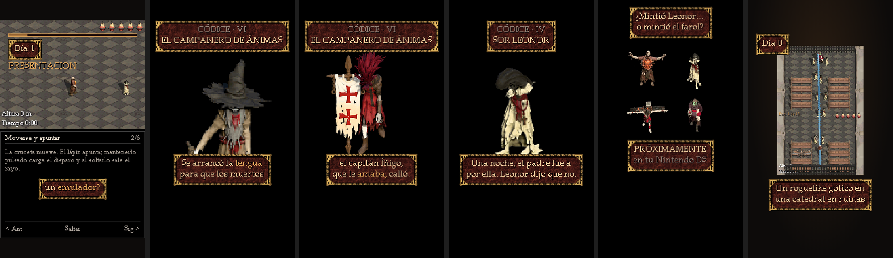
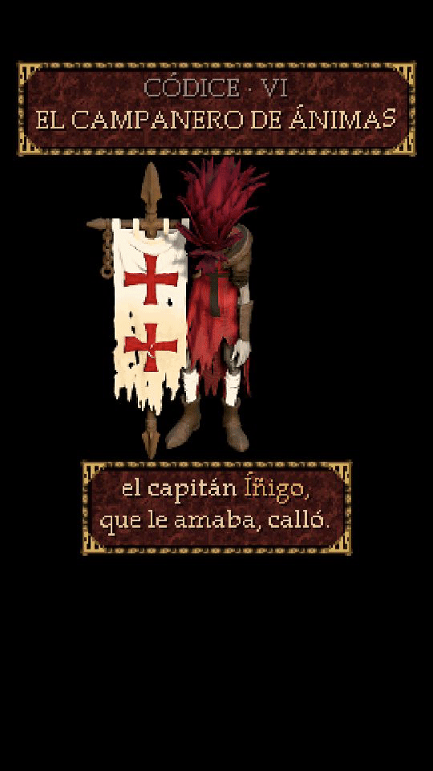
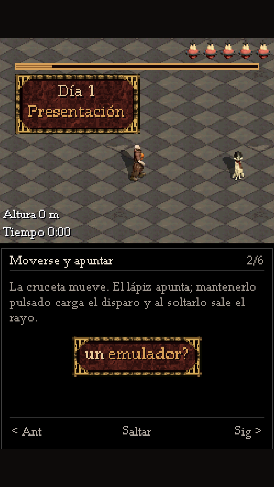

# Vídeos de lore y devlog: tema visual propio

Motivo: alguien dijo que los vídeos parecían genéricos de IA. Ahora todos los textos (lore y devlog) usan el arte del juego: fondo negro, cajas con la piedra del inventario ARPG teñida de rojo y marco dorado de esquinas ornamentadas, letra Palatino a 1 bit del juego (13 px, x5 NEAREST, sombra 1 px), marfil/oro/ceniza.

Elección del usuario: fondo negro + textos del estilo A, luego cajas con arte del inventario (E). Rondas en [`rondas/`](rondas/ronda.html).

## Qué cambia
- `tools/video_theme/`: `build_kit.py` (lee el arte de `proto/arpg:include/inv_art.h`), `theme.py` (cajas, ajuste de línea, barra de progreso) y `kit/` (3 PNG + `theme.json` con atlas de glifos).
- `render_guiones.py` y `render_codice_video.py`: textos como overlays PNG del tema, no drawtext/ASS. Se retira el texto duplicado «Deja tu veredicto en los comentarios» del cierre.
- Skill `codice-lore-video`: sección «Tema visual» (ningún texto de vídeo fuera del tema).
- El proyecto Remotion vive fuera del repo (`C:\codexlocal\devlog`) y lleva el tema copiado, sin commit.

## Evidencia
- Antes y después: 
- Lore11 con subtítulos: 
- Devlog1, etiqueta: 

## Verificación y pendiente
Fotogramas y GIF revisados a mano. `render_codice_video.py` no se ha ejecutado (sus configs necesitan ElevenLabs): solo comprobada la sintaxis.

MDs: STATUS.md, STATUS-ARCHIVE.md y assets/MANIFEST.md; el resto sin cambios.
