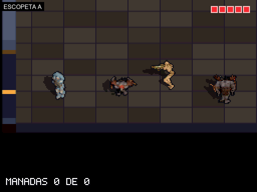
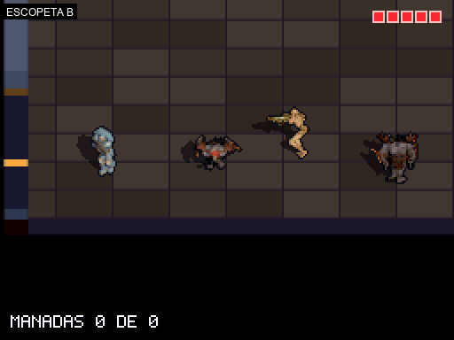
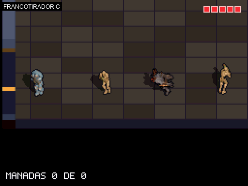
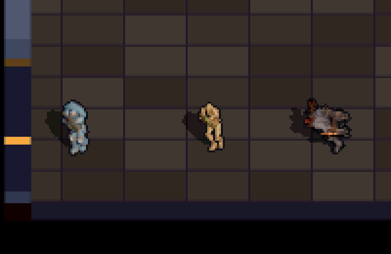
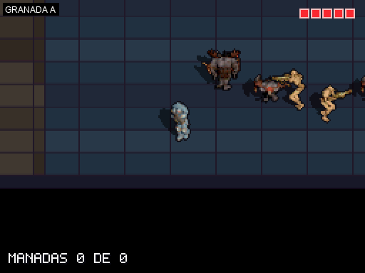

# Walkthrough: variedad de armas y efectos (proto/weapon-previews)

Rama `proto/weapon-previews`. Fecha: 2026-11-05/06. Decisiones de diseño en `DESIGN.md` §4.9.

Todos los GIFs son capturas de la ROM real en DeSmuME (no mockups), sacadas con las escenas del sandbox (`tools/sandbox_scenes.py`, `scenarios/sandbox_*.json`): enemigos parados en posiciones exactas y héroe invulnerable. El emulador solo sirve para comparar el aspecto; el rendimiento a 60 FPS se validó en la DS con la variante `playground-perf` (el usuario lo probó jugando; `AGENTS.md` regla 6).

## Qué se ha hecho

- **Granada** como tercera arma del ciclo `L`: apuntas a un punto del suelo y explota 1,5 s después (mecha 90 frames, radio 56 px, daño 60 en el centro que baja a 15 en el borde, fuego amigo, los muros protegen, máximo 2 activas). Tres variantes del aviso previo (A/B/C) y explosión común irregular (no un círculo).
- **Variantes de efectos** A/B/C para escopeta y francotirador. `SELECT` rota el estilo A/B/C de todas las armas en vivo.
- **Aura de carga del francotirador**: tres variantes K/C/V que se cambian con `Y`.
- **Regla de perspectiva del suelo**: todo lo que va en el suelo es una elipse 2:1 pintada bajo sprites y respetando muros (`groundfx`).
- **Sandbox y ROM playground** para comparar en la consola: 13 maniquíes parados, héroe invulnerable, `L` arma, `SELECT` estilo, `Y` aura, `R` respawn, `START` HUD. Skill `ds-game-dev` ampliada (`references/sandbox-pattern.md`).

## Escopeta

| A. Estelas cortas | B. Estallido en cono con casquillo y humo | C. Pesada con onda de choque y polvo |
| :---: | :---: | :---: |
|  |  |  |

## Francotirador: haz y disparo

El disparo en sí, tres estilos. Estas capturas son anteriores al aura de carga (la sección siguiente muestra la carga completa).

| A. Trazo largo que se desvanece | B. Anillos de choque en la boca y en cada enemigo | C. Trazo de dos tonos con retícula |
| :---: | :---: | :---: |
|  |  |  |

## Francotirador: aura de carga

Mientras se carga el disparo el personaje desprende un aura de rayos. Regla común: lo que pasa por detrás del cuerpo lo tapa el sprite y los muros ocluyen. Carga, unos 70 frames al máximo y disparo.

| K. Rayos finos que envuelven el cuerpo (por defecto) | C. Corona de rayos desde el suelo | V. Chispas verticales |
| :---: | :---: | :---: |
|  |  |  |

Iteraciones descartadas: doble hélice azul (H) y espiral de arcos (v2), por parecer un garabato continuo en vez de chispas. Las referencias fueron rayos de Killua y SSJ2.

## Granada

Tres variantes del aviso previo, con la explosión común (bola de fuego irregular de 7-9 lóbulos, onda de choque con huecos, escombros, humo tramado, temblor de 4 px y hitstop 3).

| A. Anillo que se contrae | B. Granada que rebota y parpadea | C. «Láser desde el espacio» |
| :---: | :---: | :---: |
|  |  |  |

La variante C pinta una zona de peligro elíptica 2:1 solo en el suelo, una columna de luz roja que ilumina a los personajes dentro del radio y un haz láser que cae en los últimos 12 frames.

## Cómo se hizo

Proceso completo en `AGENTS.md`, sección «Flujo de VFX»: mockups para elegir, implementación real con selector de depuración, sandbox con capturas de la ROM, iteración con referencias (aura: chispas verticales, hélice, doble hélice, rayos angulosos, rayos finos) y medición final en la DS con `playground-perf`. Los GIFs `sbx_*` y `sniper_aura_*` salen de `tools/sandbox_scenes.py` y `tools/sandbox_gifs.py`; los mockups de la fase de elección están en `scripts/`.

## Verificación

- Tests de host: 138 OK (`python -m unittest discover -s tests -p "test_*.py"`; `test_enemy_fsm.py` no existe, preexistente).
- Compilación de las variantes `sandbox` y `playground`: 0 warnings.
- Escenarios headless `sandbox_{grenade,shotgun,sniper}_{A,B,C}`, `sandbox_sniper_aura_{K,C,V}` y `playground_smoke`: PASS.
- Bug encontrado y corregido: un bucle infinito en el dibujo de segmentos del aura congelaba el juego; ahora hay un tope de pasos.
- Regresión de velocidad de la granada C en emulador corregida con oclusión por tramos (`world_span_hidden`).

## Pendiente

- Rendimiento en la DS: el usuario probó la ROM `playground-perf` (todas las armas, estilos y auras) y reportó que va bien. Falta archivar el log de `/dungeonds_perf.log` si se quiere dejar constancia numérica.
- Revisión línea a línea del código escrito por los agentes Haiku.
- Elegir variante definitiva de aura, de aviso de granada y de estilo de arma, y borrar el selector de depuración.
- Actualizar `TECHNICAL.md` con el pase de suelo/luz y `groundfx`.
