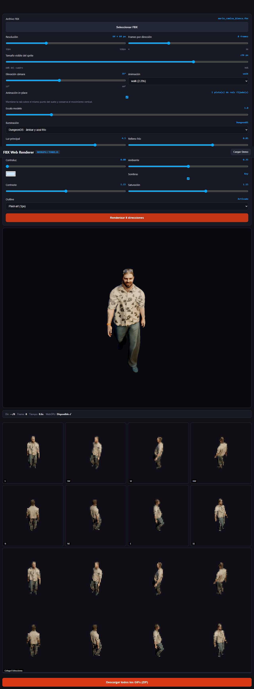

# Paridad de iluminación entre Blender y el visor FBX web

## Cambios

- El preset `DungeonDS` comparte ahora con Shader Lab los valores de referencia: key `4.5`, fill `0.85`, rim `0`, mundo `0.35`, contraste `1.15` y saturación `1.15`.
- Los colores del preset web están codificados en sRGB para que, al convertirse a lineal en Three.js, representen los valores RGB lineales de Blender.
- Se sustituyó el HemisphereLight por una luz ambiente uniforme, equivalente más cercana al World blanco de Cycles.
- Se activa AgX y se aplica al canvas el contraste/saturación seleccionados. Los controles del render de sprites ya aplicaban ese grading.
- Las intensidades Three.js se convierten internamente con factor `2` para compensar la diferencia de unidades y aproximar el brillo de Cycles; los controles siguen mostrando los valores de Blender.
- Se ajustó la orientación al sistema de coordenadas de la cámara Y-up del visor y la fuerza de normal maps a `0.35`, como en el worker de Blender.

## Verificación

- Chromium headless cargó `mario_camisa_blanca.fbx`, detectó la animación `walk` y renderizó las ocho direcciones y el collage en aproximadamente `0.6 s`.
- Consola: cero errores JavaScript. Las advertencias restantes proceden de FBXLoader (metadatos SpecularFactor/ShininessExponent, más de cuatro pesos y conversión Z-up).
- Captura real del visor y del preset aplicado:

La salida no es pixel a pixel idéntica: Cycles y Three.js usan modelos de materiales y sombras distintos. La escena, paleta, controles y grading ahora parten de la misma configuración y la intensidad del visor está compensada visualmente.
