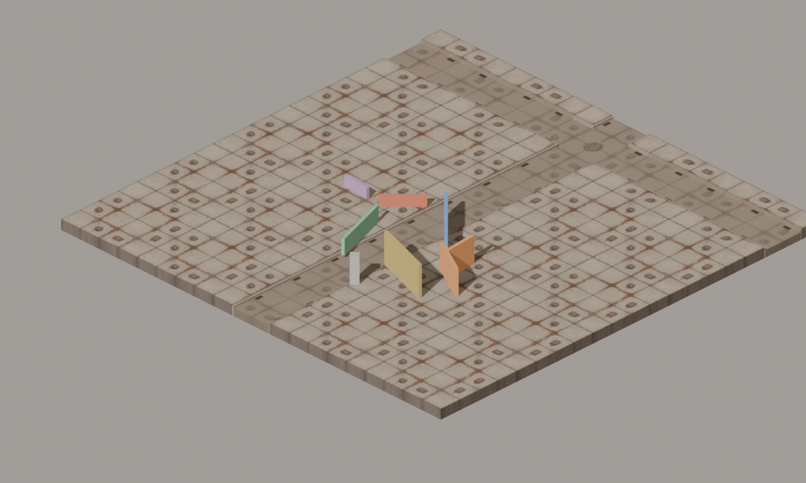
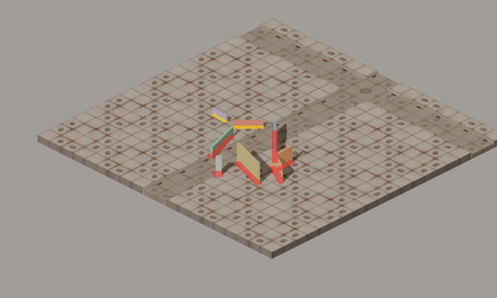
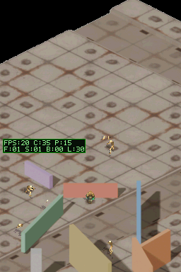
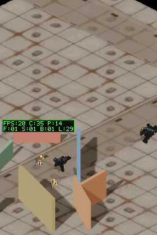
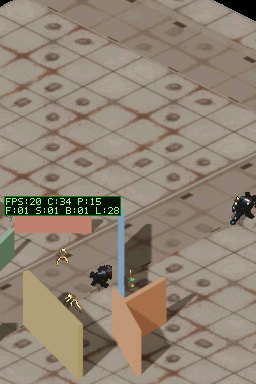

# Arena sintética para aislar colisión y oclusión WH40K

## Objetivo

Separar el bake offline de la respuesta online del motor ante paredes. La arena reemplaza únicamente los props FBX por cajas 3D programáticas. Conserva el mismo código C del motor, el suelo real WH40K, Blender, la cámara, la iluminación, la conversión a tiles BG y el empaquetado de colisión/oclusión.

El proyecto y la ROM de prueba viven en `artifacts/collision-arena/`, ignorado por Git. No se modificó el mapa normal ni se subió esta ROM a la DS.

## Arena y escala

El bake mide 1280×768 px, usa `ORTHO_SCALE=75`, una rejilla de colisión 320×192 y un sector. La escala sigue siendo 17,07 px/m, igual que el mundo de cuatro sectores de 3200×1920 px con escala 187,5. El spawn está en (640,384). La geometría de prueba contiene muros cerrados a 0°, 45°, 90°, 135° y 150°, alturas de 1,2 a 3,6 m, un tramo corto, una esquina en L y un pilar.

Las posiciones y orientaciones de las cajas se convierten desde coordenadas de pantalla con la matriz Euler real de la cámara de Blender. Esto coloca las cuatro paredes de prueba sobre las rutas UP, RIGHT, DOWN y LEFT del motor.



*Render prehorneado que entra al generador BG. Sirve para confirmar suelo, escala y distribución de las cajas; no demuestra colisión en el motor.*



*Visualización del bake: rojo marca celdas sólidas para caminar y proyectiles; amarillo marca walk-only. Es salida del generador, no una captura del juego.*

## Flujo comprobado

1. **Offline:** Blender genera el suelo y las cajas, renderiza el mundo y el pase RGBA de props, y bakes las rejillas de colisión y profundidad de oclusión. El generador convierte la escena en tiles de hardware y arrays C.
2. **Online:** `position_is_free()` consulta el suelo y los flags `COLL_WALK` del array C. El render del actor usa por separado el mapa de profundidad de oclusión.
3. **Resultado:** el motor bloquea correctamente la pared baja cuando el bake incluye flags de caminar. Las cajas altas conservan silueta/oclusión renderizada, pero el bake no les asigna `COLL_WALK`; por eso el motor permite atravesarlas.

## Hallazgo concreto

El bake actual prueba el movimiento con un rayo vertical que empieza en `SIDEWALK_Z + 1.20` y recorre 1.19 m hacia abajo. En las cajas cerradas de más de 1,2 m, el inicio queda dentro del volumen; la cara inferior está a 1,20 m, fuera de esos 1,19 m. La prueba por raycast no detecta la caja. La pared de 1,2 m sí aporta celdas caminables porque su cara superior coincide con el inicio del rayo. El overlay final contiene 62 celdas walk-only de la geometría baja; los muros altos aparecen en el canal de proyectiles, pero no en el de caminar.

Esto confirma un defecto del bake offline para estas paredes programáticas. A la vez, el contacto con la pared baja demuestra que el runtime lee y aplica los flags de caminar. El hallazgo no asegura que todos los FBX originales tengan exactamente la misma topología; sí da una reproducción mínima y medible del fallo.

## Escenarios DeSmuME

La prevalidación de los cuatro botones pasó en la ROM final (CRC DeSmuME `2C0163BA`). Cada escenario arranca en el mismo spawn y captura estado de `g_nav_state`:

| Dirección | Pared | Resultado |
| --- | --- | --- |
| UP | 1,2 m, horizontal | `y` se estabiliza en 86539; durante la espera sube `blocked_moves` de 166 a 176 y `moving=0`. |
| RIGHT | 2,4 m, vertical | Cruza el centro de la pared y continúa; `blocked_moves=0`. |
| DOWN | 3,6 m, diagonal | Continúa más allá de la pared; `blocked_moves=0`. |
| LEFT | 1,8 m, diagonal | Continúa más allá de la pared; `blocked_moves=0`. |



*Captura real de la ROM compilada: el jugador se detiene en UP y el estado de movimiento queda inactivo. Confirma la respuesta del runtime cuando hay celdas caminables.*



*Captura real en el punto medido del escenario RIGHT. El estado confirma que el jugador ha alcanzado el centro proyectado de la pared sin incrementos de `blocked_moves`; esta imagen sola no mide la posición.*



*Captura real tras mantener RIGHT: el estado confirma avance adicional y cero bloqueos. El escenario también guarda los estados numéricos y el log.*

## Reproducción

El proyecto temporal incluye el código C copiado del worktree, los headers generados, los cinco escenarios y la ROM:

```powershell
& .\scripts\build-project.ps1 -ProjectPath .\artifacts\collision-arena
& .\scripts\run-scenario.ps1 -RomPath .\artifacts\collision-arena\collision-arena.nds -ScenarioPath .\artifacts\collision-arena\scenarios\collision_arena_input_preflight.json -OutputPath .\artifacts\collision-arena\evidence\input-preflight
```

El bake se recrea con `WH40K_COLLISION_TEST=1` y `WH40K_OUTPUT_ROOT=artifacts/collision-arena` en `tools/assemble_wh40k_full_sector.py`; el proyecto temporal necesita las carpetas `source`, `include`, `tools` y `.ds-game-dev` antes de ejecutarlo.

## Límites y siguiente paso

- La compilación BlocksDS terminó correctamente; la prevalidación de entrada y los cuatro escenarios de dirección pasan en DeSmuME.
- Los escenarios altos son sondas de reproducción: su PASS confirma que el estado cruza las cajas sin flags de caminar. No significa que la colisión alta esté arreglada.
- Esta ROM se subió por FTP el 2026-10-13 a `ftp://192.168.1.151:5000/roms/nds/dungeonds.nds` (`FTP_UPLOAD_RESULT=PASS`). La arena sigue pendiente de validación física del usuario.
- El bake de oclusión se genera por separado; estas capturas no prueban por sí solas que los pies queden ocluidos correctamente en cada orientación.
- El siguiente cambio debe corregir la consulta offline de volumen para cajas altas y repetir exactamente estos escenarios. Después se compara el mapa de oclusión y se prueba la ROM en la DS.
