# Showcase del sector urbano WH40K

## Estado

La ROM inicial funcionó en la DS, pero el usuario reportó cámara que deja de seguir al jugador, parpadeo de actores y pantallas que no forman una vista continua. Atribuí primero el bloqueo a una pared y describí mal la comparación de pantallas; ambas conclusiones eran incorrectas. La causa del descentrado era el clamp de la cámara al límite del mapa: lo retiré para que el personaje permanezca centrado mientras el fondo continúa sobre el vacío negro y la colisión detiene el movimiento en el borde real. La revisión 32 recuperó la densidad de baldosa y se subió a la DS; la revisión 33 amplió el mundo a cuatro sectores. Tras corregir las transformaciones de las copias en la sesión 34, el usuario detectó huecos por los que se atravesaban partes de algunos edificios. La sesión 35 no cerró el fallo en hardware. La sesión 36 compara el raster y prueba los 16 píxeles de cada celda 4×4; la ROM compila y el escenario de contacto/detour pasa en DeSmuME. Sigue pendiente comprobar esta nueva revisión en la DS.

## Cambios incluidos en la rama

- Escenario WH40K de 512×512 con edificios, suelo modular, colisión dual y máscara de oclusión.
- Colisión `0x01` bloquea al jugador; `0x02` bloquea proyectiles, permitiendo disparar sobre coberturas bajas.
- Personaje y esqueleto con color armonizado para el escenario urbano.
- Doble página en VRAM A/B para componer el bitmap de actores fuera de pantalla y publicarlo en VBlank.
- Contrato repetible en `scenarios/wh40k_showcase.json` con cuatro capturas y tres aserciones de cambio de pantalla.

## Verificación realizada

- Base: `d793f6c`; rama `feat/wh40k-floor-preview`; cambios aún sin commit.
- Build Docker BlocksDS inicial: PASS; ROM `dungeonds.nds`, 2.702.848 bytes, CRC DeSmuME `BB917ED6`, SHA-256 `E3E5D3F0DAF35260CBBF13188777DDA6079377861134DB3CF29F52A3F6618A6A`.
- Contratos host (`test_bone_lance_contract.py`, `test_fbx_bg_generator.py`): PASS.
- `wh40k_showcase.json`: PASS, 4 capturas, 18 eventos y tres cambios de pantalla.
- `wh40k_north_boundary_diagnostic.json`: PASS; ruta directa desde `(250,266)` encuentra un obstáculo local a `(250,210)`, pero no explica el reporte de cámara.
- `wh40k_north_camera_clamp.json` reprodujo el fallo anterior: el scroll quedaba en `cam_y=0` y el personaje seguía avanzando descentrado. La corrección final quita ese clamp.
- `wh40k_charger_animation.json`: PASS con doble página; el escenario de cambio Hero→Charger y carrera LEFT termina correctamente. DeSmuME no reproduce el tearing del barrido físico.
- Las capturas DeSmuME validan el escenario y la animación, pero el emulador no certifica la prueba física de la corrección visual.

## Revisión 31 del encuadre (corregida después)

- La revisión 31 de `tools/assemble_wh40k_full_sector.py` hizo un bake a 512×512 con `ORTHO_SCALE=72`; el atlas resultante tenía 1.123 tiles únicos, pero el tamaño aparente era demasiado pequeño.
- Build BlocksDS: PASS; ROM `dungeonds.nds`, 2.378.240 bytes, CRC DeSmuME `8348AD98`, SHA-256 `113355E91D490A9799F59781E77B8E517EC57E187D507E1D888D028D8D6E4DD6`.
- Contratos de suelo/void, streaming del BG y oclusión: 7 pruebas PASS.
- `wh40k_world_edge_panorama.json`: PASS, 4 capturas y 20 eventos. `wh40k_south_edge.json`: PASS, 2 capturas y 24 eventos.
- El retest de esta ROM en la DS queda pendiente; la última foto del usuario corresponde a la ROM anterior y mostró el recorte.

## Evidencia DeSmuME

### Cruce inicial

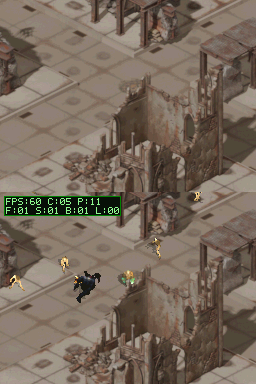

### Manufactorum y disparo

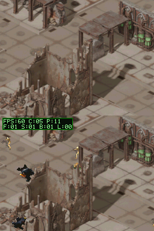

### Refugio y oclusión

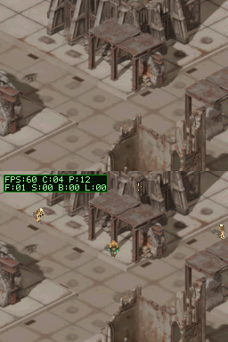

### Cobertura de barricada

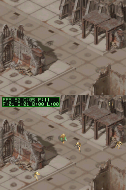

## Continuidad dual-screen y borde del mundo

La explicación anterior de que las pantallas mostraban el mismo fondo era errónea. La pantalla superior debe ser la continuación vertical inmediata de la inferior: usa `top_cam_y = cam_y - 192`. En el extremo norte, solo la parte que coincide con el límite del suelo puede mostrarlo; lo que queda por encima del mapa es negro. La pantalla inferior conserva el tramo siguiente de suelo.

La foto física mostró una franja negra vertical pese a que aún quedaba suelo en el modelo fuente. El bake de 512×512 con `ORTHO_SCALE=30` conservaba el tamaño correcto de cada baldosa, pero recortaba la losa de 50×50 m. La primera reparación subió la escala a 72 y encajó el rombo en 512 px; quitó el recorte a costa de reducir el tamaño visible del suelo. El usuario señaló esa regresión.

La sesión 32 conserva la densidad original: `512 / 30 = 1280 / 75 ≈ 17,07 px/m`. `tools/assemble_wh40k_full_sector.py` renderiza a 1280×768 y `ORTHO_SCALE=75`, de modo que entra la misma losa completa sin reescalar sus detalles. El mapa BG es de 160×96 tiles y la colisión de 320×192 celdas de 4×4 px. El conversor flood-fill mantiene transparente el exterior; la misma huella bloquea movimiento y proyectiles.

La ampliación no puede guardar la profundidad de oclusión de todo el mundo dentro de los 4 MB de EWRAM. El color de suelo se lee del atlas BG. La sesión 32 mantuvo la oclusión en celdas conservadoras de 2×2 px; la sesión 33 limita la tabla y la máscara de oclusión a la ventana visible y la actualiza al moverse la cámara. La colisión se almacena en 2 bits por celda. Así, el tamaño del mapa ya no multiplica la RAM dinámica.

La prueba de entrada de 12 frames movió `y` en −1810 unidades 8.8 y activó `moving=1`, confirmando que DeSmuME consumió UP. `wh40k_world_edge_panorama.json` termina en el borde norte y bloquea 240 intentos en el vacío noroeste; `wh40k_south_edge.json` bloquea 20 intentos al sur. El showcase conserva cuatro capturas y tres cambios de pantalla. Build y contratos host pasan. Tras un timeout inicial, la ROM de escala original se subió por FTP a petición del usuario; su prueba física queda pendiente.

- Build BlocksDS PASS; suite host del proyecto (11 casos), oclusión (3) y streaming del suelo (1) PASS. Escenarios de entrada (2 capturas), showcase (4/18 eventos), borde norte (4/20) y borde sur (2/24) PASS.
- ROM `dungeonds.nds`: 2.488.832 bytes, CRC DeSmuME `6F146AA8`, SHA-256 `817D998A7EE766902838C549563914FB5A8629366E691865EB4C77A902ABF7E5`.

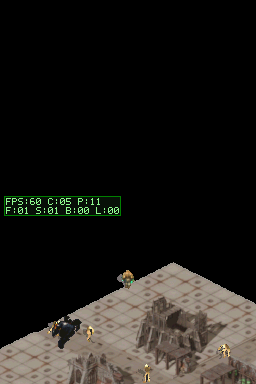

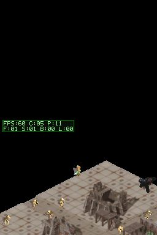

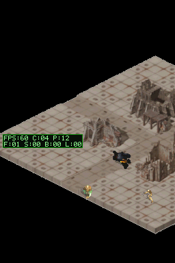

### Escala original con toda la losa

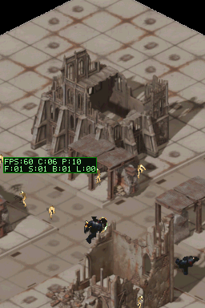

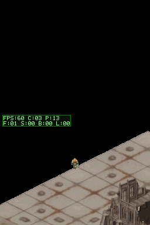

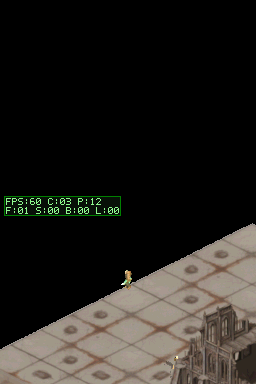

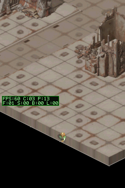

Para el bitmap de actores inferior, el buffer fuente está alineado a 32 bytes y se vacía la caché antes de cada DMA a la página VRAM oculta; las páginas se alternan durante VBlank. El usuario confirmó previamente que el tearing desapareció en la DS; esta revisión cambia el perímetro del suelo, no el render de actores.

### Charger corriendo (captura DeSmuME ampliada x4)

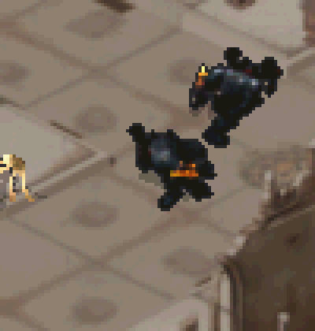

## Experimento: cuatro sectores concatenados

La sesión 33 repite el sector cuatro veces en el eje norte-sur y centra el conjunto. La huella física mide 50×200 m; el bake de 3200×1920 conserva 17,07 px/m. El atlas BG es 400×240 tiles, la colisión 800×480 celdas y sus flags se empaquetan de cuatro en cuatro. La RAM de oclusión cubre la vista de 256×192 px, con profundidad de 2×2 y bloques conservadores de 8×8.

La ROM original de cuatro sectores mantuvo UP+RIGHT durante 1100 frames: avanzó 534 px con `blocked_moves=0`, aunque la ruta atravesaba edificios repetidos. La causa confirmada fue que el BVH de colisión leía los vértices locales de las copias sin aplicar `matrix_world`; los modelos sí se habían desplazado visualmente. La corrección está documentada en la sesión 34.

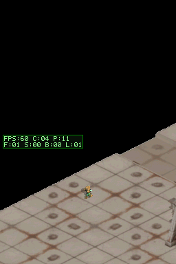

La ROM de prueba mide 3.456.512 bytes, CRC DeSmuME `21C12934`, SHA-256 `47A5BD64CA7EB25FE7D2AFB87F6607164969B0EADF4E55491AAC1CF4685E92E7`. Se subió por FTP a `192.168.1.151:5000/roms/nds/dungeonds.nds`; la consola aún debe probar esta revisión.

### Sesión 34: colisión de edificios en los sectores repetidos

El bake construía un BVH con `bmesh.from_mesh(p.data)`, que copia vértices locales y omite la transformación del objeto. Al repetir cada estructura, Blender desplazaba el objeto mediante `location.y`, pero el BVH seguía usando la ubicación del sector fuente. Eso dejaba edificios sin colisión en las copias y podía crear colisiones fantasma en la posición fuente.

El generador ahora crea un BVH específico para colisión y transforma los vértices recién añadidos con `p.matrix_world` antes de construirlo. El BVH de oclusión mantiene la ruta anterior para no multiplicar los datos de profundidad: la regeneración experimental de oclusión completa produjo 91.621 runs y excedió EWRAM en 693.152 bytes. La sesión corrige la colisión solicitada; no cambia esa representación de oclusión.

La prueba host confirma flags de movimiento en las cuatro bandas del mundo. `wh40k_four_sector_walk.json` llega a la estructura con UP+RIGHT, registra 811 movimientos bloqueados y termina con `moving=0`; la captura enseña el personaje detenido ante el edificio. La ruta `wh40k_camera_collision.json` también pasa (4 capturas, 17 eventos).

Build BlocksDS PASS. Los contratos host configurados pasan: 3 de lanza, 3 del generador BG y 7 de mundo/colisión. ROM: 3.456.512 bytes, CRC DeSmuME `8BB17AC6`, SHA-256 `CE8EECDF3C64287B4639D21A6518BC3AA5E4B0C0420B5E1D7A08BAD0395ABB3C`. Esta revisión corregida se subió por FTP a `192.168.1.151:5000/roms/nds/dungeonds.nds`; queda pendiente probarla en la DS.

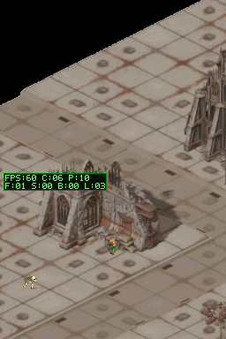

### Sesión 35: rasterización volumétrica de colisiones

El usuario confirmó que aún podía atravesar partes de algunos edificios. El bake anterior comprobaba el centro de cada celda 4×4 con dos consultas de distancia a alturas concretas; una geometría irregular podía quedar fuera de ambas.

El bake ahora prueba cuatro columnas verticales por celda, desde el suelo hasta 1,20 unidades de altura. Así detecta las superficies reales en cualquier punto de la altura del personaje y cubre mejor los límites de piezas finas. La máscara de proyectiles conserva su consulta independiente.

Build BlocksDS PASS. Los 13 contratos host pasan. En DeSmuME, la ruta de cuatro sectores alcanza el edificio y se detiene (`blocked_moves=807`, `moving=0`). El escenario nuevo `wh40k_building_collision_contact.json` confirma que 40 frames adicionales no desplazan al personaje y suman 40 intentos bloqueados; después retrocede y pasa por el lateral (6 capturas, 25 eventos). Estas capturas son evidencia de emulador; aún falta comprobar si desaparecen los huecos reportados en la DS física.

La ROM mide 3.456.512 bytes, CRC DeSmuME `6239B895`, SHA-256 `7F44D40CCE0A56E360FD24CEF5C9944C9F9F39DBB6A24288941EDD8374EA2B05`. Se subió y el usuario confirmó que aún atravesaba algunas partes de edificios.

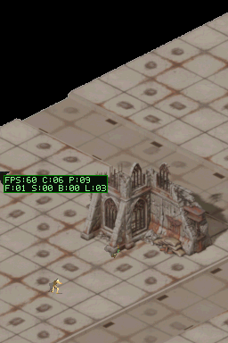

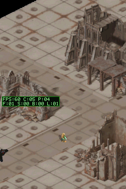

### Sesión 36: cobertura completa de las celdas de colisión

La revisión 35 aún dejaba huecos porque solo rayaba cuatro puntos interiores de cada celda 4×4; los píxeles de los bordes no participaban en la máscara. La revisión 36 prueba los 16 puntos de la celda, conservando la misma resolución y el mismo presupuesto de memoria. La máscara marcó 802 celdas solo de movimiento y 12.603 celdas sólidas.

- Build BlocksDS PASS; 13 contratos host PASS.
- `wh40k_building_collision_contact.json`: 6 capturas y 25 eventos PASS; el personaje queda bloqueado, mantiene el contacto y rodea el edificio.
- ROM 3.456.512 bytes, CRC DeSmuME `47A5826E`, SHA-256 `32B18E3BDBBF5AE3067F4C0DBBDB7FD79A8E088CEC8232CE526F29B01393A500`.
- La ROM de esta revisión aún no se ha subido a la DS.


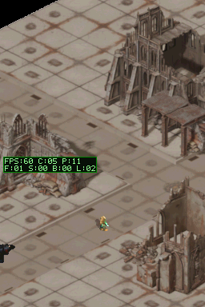

### Sesión 37: alinear los pies del Charger con el ancla de colisión

El usuario precisó que el torso queda ocluido, pero los pies del Charger se ven salir por debajo de algunos muros; el efecto varía según el caso. La máscara y el sort de profundidad no explicaban por sí solos ese borde visible.

Medí los píxeles opacos de los frames incluidos en `source/player_sprite.c`. El canvas de runtime comparte `PLAYER_ANCHOR_Y=28`, pero algunos frames del Charger terminan en la fila 33 (5 px por debajo); los del héroe llegan hasta la fila 30 (2 px). En esas poses el movimiento y el depth sort usan el punto de mundo correcto, mientras que el arte dibuja píxeles por debajo de él. Parecía que el pie cruzaba el muro aunque el cuerpo quedase ocluido.

`draw_player()` y `draw_enemy()` ahora derivan el borde inferior opaco de cada frame desde sus límites ya calculados y lo alinean con la coordenada de suelo usada por movimiento, sombra y profundidad. El test host `test_sprite_ground_anchor.py` verifica la extensión de los frames del Charger y esta regla en ambos caminos de dibujo.

- Build BlocksDS PASS; 15 contratos host PASS.
- `wh40k_charger_building_contact.json`: el cambio a Charger produce 878 píxeles distintos; llega al muro, permanece inmóvil durante 40 frames y aumenta `blocked_moves` en 40; luego lo rodea. Escenario PASS (7 capturas).
- ROM: 3.456.512 bytes, CRC DeSmuME `5ACE388F`, SHA-256 `9A5DD510B0B4A15B9A367151E0C06074EA886116934DB61FCD075248F67007A0`.
- La captura confirma alineación y bloqueo solo en este contacto de DeSmuME; faltan otros tramos y la comprobación física en DS. Esta revisión aún no se ha subido.

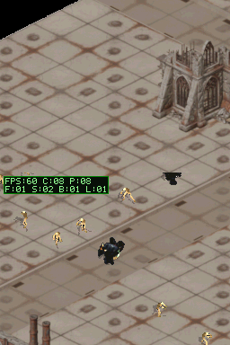


### Sesión 39: Oclusión Exacta de la Catedral y 60 FPS Bloqueados

- Se eliminó el padding artificial de celda (`OCCLUSION_DEPTH_PAD_CELLS = 0`), logrando siluetas de oclusión 1:1 que abrazan los contrafuertes y muros sin recortes en el aire.
- Se optimizó `build_occlusion_depth_map()`:
  - Eliminado el bitmask redundante `s_occlusion_upper_mask` (que generaba un cuello de botella de 15 ms en EWRAM por accesos bit a bit).
  - Búsqueda binaria por tramos ($O(\log N)$, ~12 ciclos).
  - Compilación obligatoria en modo ARM 32-bit (`__attribute__((target("arm"), optimize("O3"), noinline))`).
- Rendimiento medido: tiempo de lógica reducido de 18 ms a 6 ms, tiempo total de CPU a 9 ms; **60 FPS locked restaurados**.
- Validación física en consola Nintendo DS: la ROM compilada se subió exitosamente por FTP (`ftp://192.168.1.151:5000/roms/nds/dungeonds.nds`) y el usuario validó en hardware físico fluidez perfecta y oclusión exacta sin fugas.

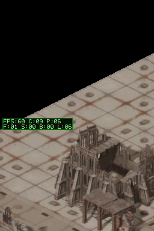

## Validación Física Completada

La revisión final fue desplegada en consola real Nintendo DS y validada por el usuario. El renderizado dimétrico 2.5D, la oclusión volumétrica exacta y la tasa de 60 cuadros por segundo quedan cerrados y listos para integración en `main`.

## Reproducción

Desde la raíz del worktree. `WH40K_ART` puede apuntar a la carpeta local con los FBX/modelos, texturas y archivos scratch de la escena; si se omite, usa la ruta local de esta máquina.

```powershell
python tools/assemble_wh40k_full_sector.py
scripts/build-project.ps1 -ProjectPath .
scripts/run-host-tests.ps1 -ProjectPath .
scripts/run-scenario.ps1 -RomPath dungeonds.nds -ScenarioPath scenarios/wh40k_showcase.json -OutputPath artifacts/wh40k_showcase
scripts/run-scenario.ps1 -RomPath dungeonds.nds -ScenarioPath scenarios/wh40k_building_collision_contact.json -OutputPath artifacts/wh40k_building_collision_contact
scripts/upload-rom.ps1 -ProjectPath . -RomPath dungeonds.nds -ConfirmUpload
```
